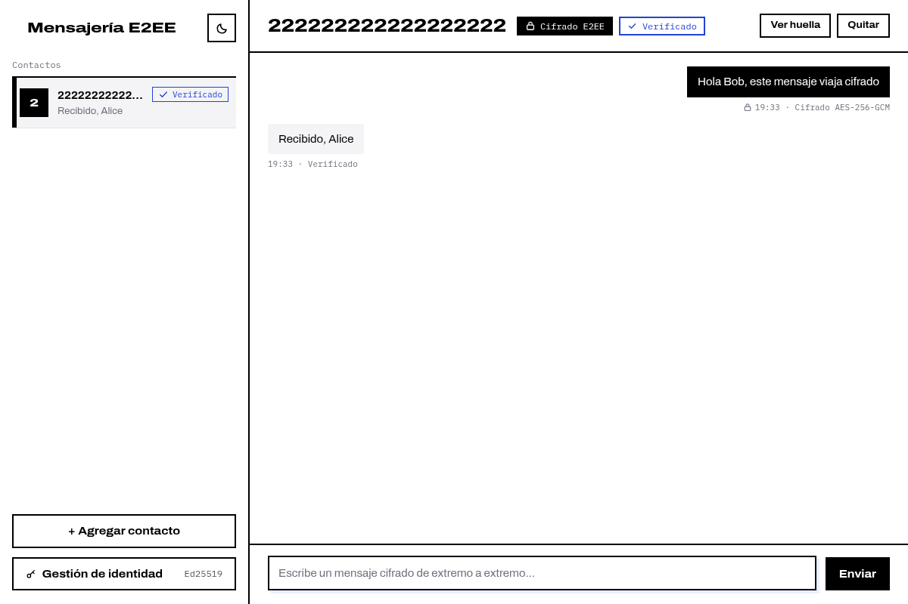
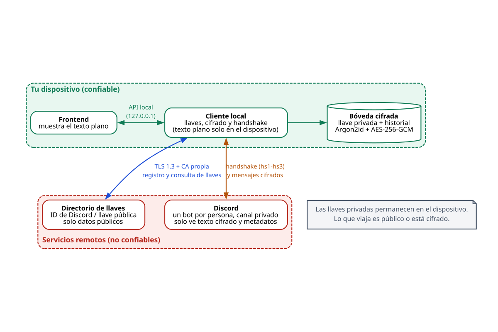
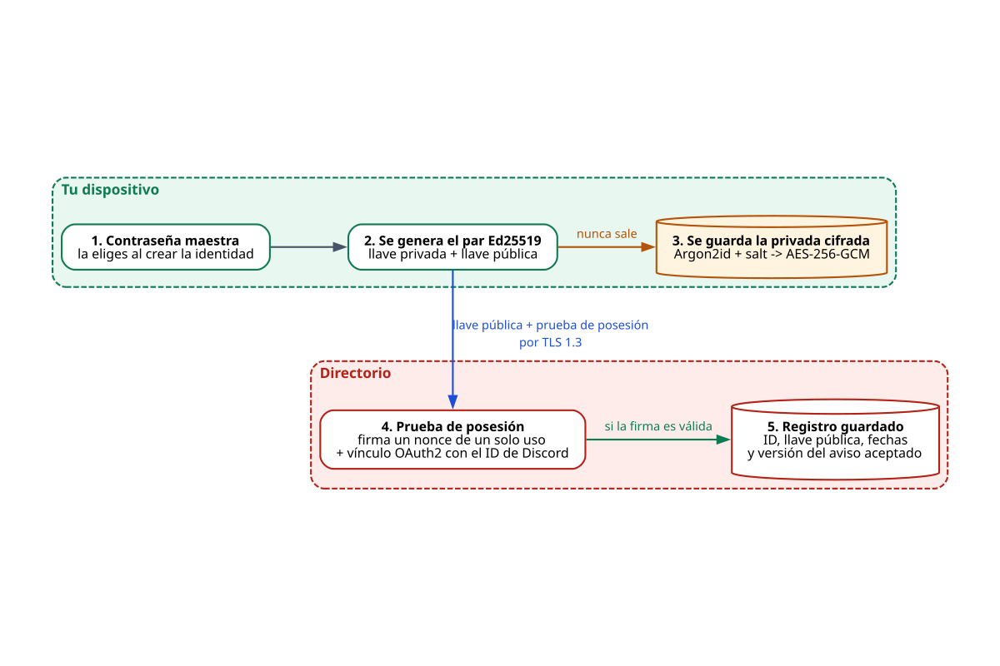
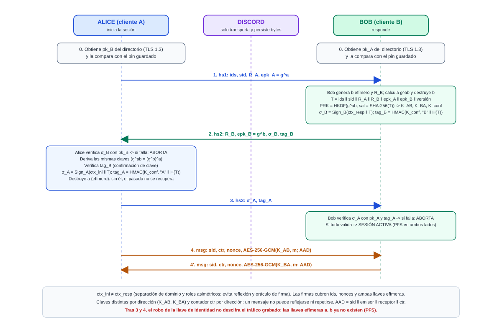
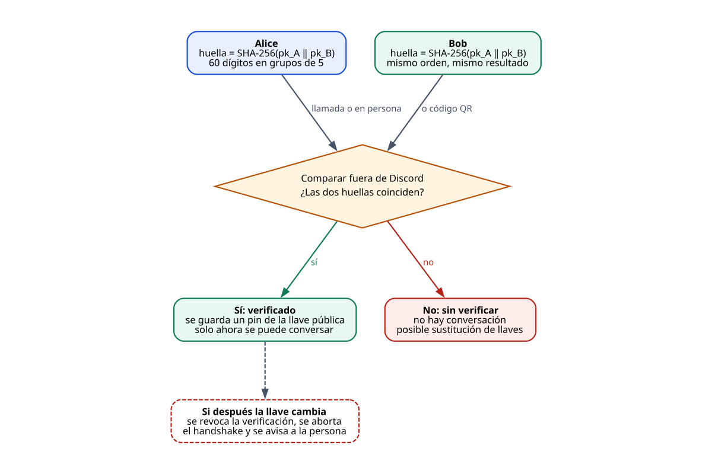

# Informe del Proyecto: Mensajería Cifrada en Discord

## 1. Motivación

Mucha gente usa Discord para trabajos en grupo, clases y hasta cosas de trabajo. El problema es que Discord no cifra de extremo a extremo los mensajes: la empresa y sus servidores pueden leerlos en texto plano. Si hay una brecha, una orden legal o un empleado curioso, lo que escribimos (contraseñas, ideas, datos personales) queda expuesto.

Nuestro proyecto pone una capa de cifrado encima de Discord. Seguimos usando la plataforma que ya conocemos, pero Discord solo guarda texto cifrado que no puede leer. Los mensajes se cifran en el dispositivo de quien escribe y solo se descifran en el de quien recibe.

## 2. Trasfondo teórico

Estos conceptos nos ayudaron a decidir cómo proteger los mensajes y las llaves.

* **Cifrado de extremo a extremo (E2EE).** Solo quienes conversan pueden leer los mensajes; el servidor en medio solo ve bytes (Alatawi & Saxena, 2023; Park et al., 2023).
* **Criptografía híbrida.** La criptografía de llave pública es lenta y la simétrica es rápida, así que se combinan. La simétrica (AES-256-GCM) cifra los mensajes y además detecta si alguien los modificó. La de llave pública sirve para identificarnos (firmas Ed25519) y para acordar una clave compartida (Diffie-Hellman sobre X25519). Cada llave hace una sola cosa: la de identidad solo firma (Stallings, 2017; Ferguson et al., 2010).
* **Hash y derivación de claves.** SHA-256 sirve para la huella de verificación. HKDF saca varias claves independientes de un mismo secreto (Krawczyk & Eronen, 2010) y Argon2id vuelve lenta la fuerza bruta contra la contraseña maestra.
* **Protocolos y *forward secrecy* (PFS).** No basta con elegir un algoritmo seguro: también importa cómo lo usamos. El modelo de Dolev y Yao (1983) nos permite pensar en un atacante que controla la red. Buscamos que ambos participantes se identifiquen, acuerden una clave y protejan sus conversaciones anteriores si más adelante se roba su llave de identidad. Esto último se llama PFS. Para lograrlo usamos llaves temporales en ambos lados y las eliminamos después de obtener las claves de sesión, siguiendo ideas de SSH y TLS 1.3. También revisamos qué pasa si alguien repite o cambia los mensajes del intercambio (Abadi & Needham, 1996; Krawczyk, 2003).
* **Directorio de llaves y ataque de sustitución.** Hace falta un lugar donde publicar las llaves públicas. Si ese servidor se compromete, puede entregar la llave de un atacante y habría un *man-in-the-middle*. La publicación de llaves funciona como un tablón; la verificación fuera de banda permite detectar una sustitución (Park et al., 2023). En nuestra implementación, el mismo servicio también valida el segundo factor y guarda sus datos privados, separados de la consulta pública.
* **Verificación fuera de banda.** La solución a la sustitución de llaves es comparar una huella de las llaves por otro canal (llamada, en persona, QR), como hacen Signal o WhatsApp (Naor et al., 2018; Alatawi & Saxena, 2023). Así no dependemos de confiar a ciegas en el primer contacto, como pasa con SSH.
* **Autenticación multifactor (MFA).** Combina la contraseña con un código temporal de la app autenticadora. Usamos TOTP (RFC 6238), compatible con Microsoft Authenticator. Este control protege el acceso desde la aplicación; no cambia la clave que cifra los archivos locales ni evita por sí solo el phishing (NIST, 2025, SP 800-63B-4).
* **Discord API.** La API oficial no deja escribir en nombre de un usuario, así que cada persona usa su propio bot en un canal privado.

## 3. Requerimientos

El proyecto tiene como fin crear una capa de seguridad en la comunicación de texto de **Discord**. Los requerimientos se derivan del siguiente modelo de amenaza.

**Modelo de amenaza**: Para el proveedor de la plataforma de **Discord** y cualquier entidad con acceso a sus servidores, se considera como adversario a un atacante pasivo y activo en la red. Se asume que es confiable el dispositivo del usuario y el sistema operativo del cliente. Queda **fuera del alcance** la protección de los metadatos, la disponibiliad del servicio y el compromiso físico del endpoint. El atacante activo puede además intervenir en el protocolo (repetir, reflejar, reordenar o suplantar mensajes del *handshake*), pero no puede romper las primitivas; y se asume que podría obtener **más adelante** la llave de identidad de un usuario, sin que eso deba exponer las conversaciones pasadas.

Para entender la distinción entre atacante pasivo y activo, se usa la definición de Dolev y Yao (1983) que menciona que la diferencia entre ambos es lo **qué puede hacer con los mensajes que ve**. El pasivo solo observa, lee, copia y almacena. En cambio, el activo puede modificar un mensaje, borrarlo, retrasarlo, reordenarlo, editarlo, etc.

Para enfocar esta distinción se ilustra esas diferencias bajo el trabajo realizado en la siguiente tabla.

| Actor | Atacante pasivo | Atacante activo |
|---    |---              |---              |
| **Discord / proveedor** | Lee el contenido de los DMs y canales; conserva el historial en sus bases de datos; lo entrega ante requerimiento legal o lo pierde en una brecha | Podría alterar mensajes en tránsito o inyectar contenido falso atribuido a un usuario |
| **Red** | Captura tráfico en una WiFi abierta o en un nodo intermedio | Se interpone en la conexión con el directorio de llaves y responde en su lugar |
| **Directorio de llaves** | Un volcado de su base de datos revela qué usuarios se registraron y cuándo| **Sustitución de llaves:** devuelve la llave pública del atacante en lugar de la del receptor legítimo |

### 3.1. Requerimientos Funcionales
* **RF1:** El sistema debe generar localmente, en el dispositivo del usuario, un par de llaves de identidad de firma (Ed25519) durante el registro inicial.

* **RF2:** El sistema debe publicar la llave del usuario en un directorio de llaves, permitiendo a otras personas obtener esa llave con el identificador de su cuenta de Discord.

* **RF3:** El sistema debe cifrar con una llave simétrica cada mensaje antes de ser enviado por la API de Discord.

* **RF4:** El sistema debe establecer una clave de sesión compartida con el destinatario mediante un intercambio Diffie-Hellman efímero autenticado con las llaves de identidad, de modo que solo ambos extremos puedan derivarla.

* **RF5:** El sistema debe detectar y descifrar automáticamente los mensajes entrantes dirigidos al usuario, mostrando el texto plano únicamente en la interfaz local.

* **RF6:** El sistema debe generar y mostrar una huella digital criptográfica derivada de las llaves públicas de ambos interlocutores.

* **RF7:** El usuario podrá marcar un contacto como _verificado_ tras completar el proceso de autentiación fuera del canal.

* **RF8:** El sistema debe notificar al usuario cuando la llave pública registrada de un contact ya _verificado_ cambie y revocar automaticamente su estado de verificación.

* **RF9:** El sistema debe indicar visualmente, por cada conversación, si el canal esta cifrado y si la contraparte está verificada.

* **RF10:** El sistema debe autenticarse frente a Discord mediante OAuth2 o token de bot, sin exponer esas credenciales en la interfaz.

* **RF11:** El sistema debe permitir identificar un mensaje que no se pueda descifrar.

* **RF12:** El usuario podra exportar e importar su identidad criptográfica para usarla en otro dispositivo , protegido por su contraseña maestra.

* **RF13:** El sistema debe autenticar a ambos interlocutores al establecer una sesión, verificando la firma del otro extremo contra la llave publicada en el directorio, y rechazarla si no coincide con la llave verificada (*pin*).

* **RF14:** El sistema debe mantener en cola los mensajes del usuario mientras la sesión no esté establecida, y enviarlos cifrados cuando el *handshake* termine.

### 3.2. Requerimientos de Seguridad

* **RS1:** La llave privada del usuario debe permanecer en el sistema y no ser transmitido a algun tercero.

* **RS2:** La llave privada en el dispositivo debe estar cifrada con una clave derivada de la contraseña maestra con **Argon2id** y con _salt_ unico por usaurio.

* **RS3:** El texto plano debe permanecer en memoria el menor tiempo posible y no debe escribirse ni en registros ni archivos temporales.

* **RS4:** Todo cifrado simétrico debe emplear AES-256 en modo GCM, con un _nonce_ de 96 bits generado por un CSPRNG del sistea operativo y jamás reutilizado bajo la misma clave.

* **RS5:** El sistema debe rechazar todo mensaje cuya etiqueta de autentiación GCM no se válida.

* **RS6:** La comunicación entre el cliente y el directorio de llaves debe realizarse sobre TLS 1.3, como defensa frente a un atacante en la red.

* **RS7:** El proceso de verificación de un usuario debe ser fuera del canal de Discord.

* **RS8:** La huella digital de verificación debe derivarse de las llaves públicas de ambas partes mediante una función hash (SHA-256), con un orden determinístico que produzca el mismo valor en ambos extremos.

* **RS9:** Las claves de sesión deben rotarse periódicamente (por número de mensajes y por tiempo) mediante un nuevo *handshake*, destruyendo las claves anteriores.

* **RS10:** Los tokens de acceso a la API de Discord deben gestionarse en variables de entorno.

* **RS11:** Todo el material criptográfico debe provenir de un generado de números aleatorios (pseudo-aleatorios) criptográficamente seguro.

* **RS12:** (*Perfect forward secrecy*) Las llaves Diffie-Hellman de sesión deben ser efímeras en ambos extremos y destruirse apenas se deriva la clave; el compromiso posterior de la llave de identidad no debe permitir descifrar sesiones pasadas.

* **RS13:** Toda firma del *handshake* debe cubrir las identidades de ambos interlocutores, los nonces, ambas llaves efímeras y la versión del protocolo, y debe llevar una cadena de contexto distinta según el rol (iniciador/respondedor). Toda sesión cuya firma o confirmación de clave no valide debe abortarse.

* **RS14:** El sistema debe rechazar mensajes repetidos, reordenados fuera de ventana o provenientes de otra sesión, mediante un contador por dirección y un identificador de sesión incluidos en los datos autenticados.

* **RS15:** Cada llave debe tener un único propósito: la llave de identidad solo firma; las llaves de sesión se derivan de forma independiente por dirección (emisor->receptor y receptor->emisor).

### 3.3. Requerimientos agregados durante la implementación

Al construir el directorio y las operaciones aparecieron requerimientos que la versión inicial dejaba implícitos. Salen del modelo de amenaza (el directorio como adversario, sección 3) y de la DPIA (restricciones C-05 a C-12); cada uno está trazado a sus pruebas en la [tabla de trazabilidad](trazabilidad.md).

* **RF15:** La persona debe poder cancelar su registro en el directorio desde su cliente, con su llave vigente y una sesión OAuth2; el registro se borra en el acto y desaparece de las copias en 30 días como máximo.

* **RS16:** Publicar, cambiar o cancelar una llave debe exigir a la vez la prueba de posesión de la llave privada (firma sobre un nonce de un solo uso, con propósito y caducidad) y el vínculo OAuth2 con el mismo ID de Discord; solo el dueño de un ID puede modificar su registro.

* **RS17:** El directorio debe operar con un rol de base de datos sin permisos de DDL ni de superusuario, usar solo consultas parametrizadas, limitar las solicitudes por origen y responder con errores genéricos que no permitan enumerar usuarios.

* **RS18:** El cliente debe confiar únicamente en la CA propia del proyecto para conectarse al directorio, rechazar certificados vencidos, revocados o de otro nombre, y no ofrecer ninguna opción para continuar ante un certificado inválido.

* **RS19:** Los registros de auditoría no deben contener texto de mensajes, llaves, tokens, IPs ni IDs en claro (los IDs se seudonimizan con HMAC); deben alimentar alertas ante abusos y conservarse 90 días.

* **RS20:** El directorio debe respaldarse a diario con copias cifradas, guardadas fuera de su servidor, con restauración probada y rotación de 30 días.

## 4. Diseño

Separamos el diseño en dos partes: cómo se usa la aplicación y cómo protege los mensajes.

### 4.1 Diseño funcional: interfaz y experiencia de usuario

La interfaz es una página web independiente de Discord. El desbloqueo habitual pide la contraseña maestra y un código nuevo de Microsoft Authenticator. La sesión local dura 30 minutos por defecto (`CLIENT_SESSION_TTL`); al vencer se bloquea y descarta las llaves de conversación. Los 30 minutos se cuentan desde el desbloqueo, aunque la persona siga usando la app. Cerrar solo la pestaña no detiene el cliente local. Si el directorio no responde, la identidad y el historial permanecen bloqueados.

Cada conversación muestra su estado:

* **Candado:** hay sesión cifrada activa. Mientras el *handshake* no termina dice "estableciendo sesión" y los mensajes esperan en cola (RF14).
* **Insignia de verificado:** la persona comparó la huella fuera de Discord.
* **Alerta de cambio de llave:** si cambia la llave de un contacto verificado, se revoca la verificación y se avisa.
* **"Mensaje no descifrable":** para mensajes que no se pueden autenticar o descifrar.

  

| Elemento de interfaz | Requerimientos |
|---|---|
| Candado y estado de sesión | RF3, RF9, RF13, RF14 |
| Insignia de verificado | RF7, RF9 |
| Alerta y revocación automática | RF8 |
| "Mensaje no descifrable" | RF11 |
| Registro, autenticación e identidad | RF1, RF2, RF10, RF12 |
| Desbloqueo con contraseña y TOTP; vencimiento de sesión local | C-25 de la DPIA |

### 4.2 Diseño de seguridad: algoritmos y protocolos

Seguimos el patrón de SSH y TLS 1.3: **identidad de largo plazo que solo firma, Diffie-Hellman efímero para la sesión y cifrado autenticado para los mensajes** (Ed25519, X25519, HKDF-SHA256 y AES-256-GCM).

> **Decisión importante.** En la primera entrega cifrábamos contra la llave pública de identidad del receptor. Nos dimos cuenta de que así no hay *forward secrecy*: quien robe esa llave descifra todo el historial. Por eso ahora la identidad solo firma y las llaves de sesión son efímeras en ambos extremos.

#### 4.2.1 Arquitectura y límite de confianza

En el **dispositivo de cada persona** quedan los mensajes legibles y las claves privadas: la interfaz muestra los mensajes y el cliente local gestiona las llaves. El **directorio**, desplegado en EC2 en Virginia del Norte (`us-east-1`) con PostgreSQL en Supabase, publica la asociación ID de Discord <-> llave pública de firma y valida el segundo factor por TLS 1.3 (RS6). PostgreSQL guarda también el secreto TOTP cifrado, hashes de recuperación y el estado necesario para impedir reutilizaciones; esos datos no se publican con las llaves. La clave `TOTP_ENCRYPTION_KEY` se configura fuera de la base. **Discord** transporta y guarda el intercambio para iniciar la conversación y los mensajes cifrados.

Como el autor que muestra Discord siempre es un bot, no confiamos en él: el emisor y el receptor van dentro del mensaje y se autentican con el *handshake*. Cada cliente ignora lo que no va dirigido a su ID.

  

#### 4.2.2 Registro y custodia de la identidad

Al registrarse, el cliente genera el par Ed25519 en el dispositivo (RF1). La llave privada se cifra con Argon2id y la contraseña maestra (RS2) y nunca sale (RS1). En el directorio solo se publica la llave pública (RF2). Para registrar, cambiar o cancelar una llave, el directorio exige OAuth2 de Discord, un código TOTP y una firma que demuestra que la persona tiene la llave privada. El flujo Discord -> Authenticator entrega un token de registro de diez minutos y un solo uso para la operación. Al vincular el autenticador se muestran diez códigos de recuperación una sola vez; se guardan fuera del dispositivo. El QR se genera en el propio servicio.

El desbloqueo habitual usa otro flujo, sin repetir OAuth2 ni guardar una autorización para la próxima vez:

| Paso | Qué ocurre |
|---|---|
| 1. Contraseña | El cliente abre la bóveda en memoria con la contraseña maestra, pero todavía no habilita las conversaciones |
| 2. Desafío firmado | Solicita un nonce de hasta 120 segundos, con propósito `unlock`, y lo firma mediante `sign_unlock`, ligado al ID y con contexto propio |
| 3. Segundo factor | El directorio verifica la firma con la llave registrada y comprueba el TOTP de seis dígitos. Rechaza códigos repetidos; cinco fallos bloquean el factor durante cinco minutos |
| 4. Sesión local | Solo si la validación termina bien se abre el historial y comienza el plazo local de 30 minutos. Un fallo de red o de autenticación mantiene la identidad bloqueada |

**Qué protege el segundo factor.** Una copia de `vault.json` y `store.enc`, junto con la contraseña correcta, se puede descifrar con otro programa. El segundo factor limita el acceso desde nuestra aplicación. La bóveda, que guarda la identidad cifrada, sigue dependiendo de la contraseña. Crear o importar una identidad ya usa la autorización del registro, por eso no repite el desafío de desbloqueo. El modo `client.dev` usa servicios en memoria y no valida MFA. La configuración real con Authenticator está desplegada y probada en EC2.

  

#### 4.2.3 Establecimiento de sesión: *handshake* autenticado con PFS

Antes de chatear, A y B intercambian tres mensajes por Discord para acordar las claves. Llamamos `T` al conjunto de datos de ese intercambio: los IDs, el identificador de sesión (`sid`), los valores aleatorios de un solo uso (`R_A` y `R_B`), las llaves públicas temporales (`epk_A` y `epk_B`) y la versión. Las firmas comprueban que estos datos no hayan cambiado.

| Paso | Qué pasa |
|---|---|
| **hs1** (A->B) | A genera su llave efímera y `R_A` y envía `ids, sid, R_A, epk_A`. Antes, ambos consultan la llave del otro en el directorio y la comparan con el *pin* si el contacto está verificado. |
| **hs2** (B->A) | B genera su llave efímera, calcula el secreto compartido, deriva las claves y **destruye su llave efímera**. Responde con su firma `σ_B` sobre `T` y una confirmación de clave `tag_B`. |
| **hs3** (A->B) | A verifica `σ_B` y `tag_B` (si fallan, aborta), deriva las mismas claves, responde con `σ_A` y `tag_A` y **destruye su llave efímera**. |
| **Activa** | B verifica `σ_A` y `tag_A`. Si todo valida, la sesión queda activa en ambos lados (RF13). |

Con HKDF se derivan tres claves independientes: `K_AB` (A->B), `K_BA` (B->A) y `K_conf` (confirmación). Los valores aleatorios se generan con el generador criptográfico del sistema operativo (CSPRNG), en lugar de un generador común (RS11).

**Por qué resiste los ataques** (RS12, RS13, RS15):

* **Autenticación mutua:** las firmas cubren toda la transcripción, así que cambiar una llave efímera las invalida.
* **PFS:** las llaves efímeras solo existen durante el *handshake*. Robar la identidad después no sirve para leer sesiones pasadas.
* **Reflexión y uso indebido de firmas:** quien inicia y quien responde firman con prefijos distintos (`ctx_ini` y `ctx_resp`). Así una firma de un paso no sirve para otro.
* **Degradación:** usamos una sola combinación de algoritmos y firmamos la versión para que no pueda cambiarse durante el intercambio.
* **Repetición de mensajes:** los valores aleatorios de un solo uso (*nonces*) y el identificador de sesión (`sid`) ayudan a rechazar mensajes antiguos; un intento pendiente caduca a los 5 minutos. Un `hs2`, `hs3` o `hs1` falso no cancela un intento legítimo en curso.

**Cola y reintentos.** Los mensajes escritos sin sesión esperan en una cola local cifrada (RF14). Si el otro no responde, el cliente destruye su llave efímera y reintenta con espera creciente (15, 30, 60 min…). Pasado el máximo, muestra "contacto no disponible".

  

#### 4.2.4 Protocolo de mensajería

1. **Cifrado.** Usamos AES-256-GCM con una clave distinta para cada dirección y un valor aleatorio de 96 bits generado por el sistema. También comprobamos el identificador de sesión, el emisor, el receptor y el contador (`sid`, `emisor`, `receptor`, `ctr`), para detectar cambios en esos datos (RF3, RS4, RS11).
2. **Envío.** Viaja por Discord como `E2EE1:{sid, ctr, nonce, ciphertext+tag}`. Hasta 900 bytes por mensaje; lo más largo se parte.
3. **Recepción.** Se revisa que `sid` sea de una sesión activa y que `ctr` no se haya visto ni esté fuera de ventana (RS14). Luego se descifra verificando la etiqueta GCM; si no valida, se marca "no descifrable" (RF5, RF11, RS5).

No firmamos cada mensaje a propósito: una firma por mensaje serviría de prueba ante terceros (no repudio), algo que una charla privada no necesita. Como SSH y TLS, firmamos el *handshake* y no cada registro.

#### 4.2.5 Rotación de claves y destrucción

La sesión de conversación se renueva con un nuevo *handshake* a los 100 mensajes, a las 8 h o cuando la persona lo pida (RS9). El vencimiento de la sesión local autenticada (30 minutos por defecto) también destruye las sesiones de conversación; ambos plazos son controles distintos. Las claves anteriores se destruyen tras una ventana corta de gracia. Como consecuencia de la PFS, Discord guarda mensajes que ya nadie puede descifrar con esas claves; por eso el cliente guarda el historial **ya descifrado** en un almacén local cifrado con AES-256-GCM (clave derivada de la contraseña maestra).

#### 4.2.6 Comparación de huellas

Las firmas no impiden que un directorio malicioso entregue una llave propia, así que añadimos la verificación (RS7). Ambos calculan `SHA-256(pk_A ‖ pk_B)` con las llaves ordenadas (RS8) y la muestran como 60 dígitos en grupos de cinco. La comparan **fuera de Discord**. Si coinciden, el cliente guarda "verificado" y una copia de la llave pública para detectar cambios; a esto lo llamamos *pin* (RF7). Si después la llave cambia, se revoca la verificación, se aborta el *handshake* y se avisa (RF8). No hay botón de "continuar de todos modos".

  

#### 4.2.7 Análisis de ataques

| Ataque | Defensa |
|---|---|
| Espionaje pasivo (Discord, red) | AES-256-GCM; las claves salen de DH efímero que no viaja |
| *Man-in-the-middle* en el *handshake* | Las firmas cubren ambas llaves efímeras y los ids (RS13) |
| Sustitución de llaves en el directorio | TLS 1.3 con CA propia, verificación fuera de banda y *pin* (RS6, RS7, RF8). **Riesgo que queda:** un primer contacto sin verificar |
| *Replay* de *handshake* o mensajes | Nonces, `sid`, contador `ctr` y ventana (RS14); caducidad de intentos |
| Reflexión | Roles asimétricos, ids firmados, claves por dirección (RS13, RS15) |
| Oráculo de firma o descifrado | La identidad solo firma con prefijo de contexto (RS15); `sign_unlock` usa un contexto distinto al registro y al cambio de llave |
| Repetición de TOTP o de un desbloqueo | Desafío aleatorio de un solo uso para `unlock`, firma ligada al ID y rechazo del código TOTP ya aceptado; no se guarda una autorización para futuros desbloqueos |
| Degradación | Suite única; versión en la transcripción firmada |
| Suplantación (*misbinding*) | Ids de ambos dentro de la firma y del AAD |
| Robo posterior de la llave de identidad | PFS (RS12). No protege sesiones **futuras** ni un dispositivo ya comprometido |
| Alteración o inyección | Etiqueta GCM con AAD (RS5) |
| Borrado o reordenamiento por Discord | Se detecta por `ctr`; la disponibilidad queda fuera de alcance |

## 5. Implementación

### 5.1 Arquitectura general

Tres piezas: el **cliente** (toda la criptografía y el único con texto plano), el **directorio de llaves** (ID de Discord -> llave pública) y **Discord** (solo transporte, con un bot y un canal privado).

### 5.2 Esquema criptográfico concreto

| Elemento | Algoritmo / parámetro |
|---|---|
| Identidad | Ed25519, un par por usuario, generado en el dispositivo |
| Acuerdo de clave | X25519 efímero en ambos extremos, destruido al derivar la clave |
| Derivación | HKDF-SHA256 con sal `SHA-256(T)`; salidas `K_AB`, `K_BA`, `K_conf` |
| Confirmación de clave | HMAC-SHA256 con `K_conf` sobre `SHA-256(T)` |
| Mensajes | AES-256-GCM, nonce de 96 bits, AAD = `sid ‖ emisor ‖ receptor ‖ ctr` |
| Custodia de la identidad | Argon2id + salt único; AES-256-GCM sobre la llave privada |
| Desbloqueo habitual | Contraseña local + desafío firmado + TOTP validado por el directorio; sesión local de 1800 s por defecto |
| Huella | SHA-256 sobre las llaves ordenadas, 60 dígitos |
| Rotación | Nuevo *handshake* cada 100 mensajes o 8 h |

### 5.3 Proceso de verificación

Está descrito en 4.2.6: huella de 60 dígitos, comparación fuera de Discord y *pin* de la llave.

### 5.4 Tecnologías

Cliente local en Python 3.12 (`cryptography`, `argon2-cffi`, FastAPI), frontend en Next.js, directorio en FastAPI + PostgreSQL, adaptador de Discord con `discord.py`, y Git con los secretos fuera del repositorio.

### 5.5 Fases de ejecución

1. Núcleo criptográfico con pruebas de los caminos de rechazo.
2. Almacén local de identidad (bóveda, exportar e importar).
3. Directorio de llaves y cliente HTTPS.
4. Integración con Discord.
5. Verificación: huellas, QR, indicadores y alertas.

### 5.6 Limitaciones reconocidas

El sistema protege el contenido, no el patrón de comunicación. Además:

* Solo hay conversaciones de dos personas; no hay grupos. Quien esté en el canal ve quién habla con quién y cuándo (metadatos).
* El *handshake* es interactivo: ambos deben estar conectados. Mientras tanto los mensajes esperan en la cola cifrada. Los reintentos solo corren con la app abierta, porque la llave efímera pendiente nunca se guarda en disco (para no romper la PFS).
* Por la PFS, Discord guarda mensajes que ya no se pueden descifrar; el historial vive descifrado en el almacén local cifrado.
* Un primer contacto sin verificar depende del directorio (TOFU).
* No hay seguridad posterior al compromiso dentro de una sesión (*ratchet* por mensaje) ni no repudio.

### 5.7 Implementación lograda

Todos los componentes de la sección 5.1 están implementados. El sistema integra la librería criptográfica, el cliente local, el frontend, el directorio, el transporte por Discord y las operaciones. El directorio está desplegado en una instancia de Amazon EC2 en Virginia del Norte, Estados Unidos (`us-east-1`), con PostgreSQL alojado en Supabase; cada cliente cifra y descifra en su propio dispositivo.

| Componente | Qué hace | Pruebas automáticas |
|---|---|---|
| `crypto/` | Identidad, bóveda, *handshake* con PFS, sesión, huella y seudonimización | 126 |
| `client/` | API local: orquesta las sesiones, la cola de salida, la rotación y las alertas | 55 |
| `frontend/` | Interfaz en Next.js | Pruebas unitarias y prueba e2e (los módulos `lib/` deben versionarse; ver la nota) |
| `directory/` | Directorio de llaves (FastAPI + PostgreSQL 17): OAuth2 y prueba de posesión, cancelación, TLS 1.3, auditoría y alertas | 68 |
| `discord_adapter/` | Un bot por persona sobre `discord.py`; solo publica mensajes `E2EE1:` | 14, incluida una conversación cifrada completa entre dos clientes reales; ensayo con la API real (`discord_adapter.smoke`) |
| `ops/` | CA propia, copias de seguridad, tarea diaria, análisis de código y trazabilidad | 10 (además de las de TLS y auditoría en `directory/`) |

**Cómo se cumplió lo propuesto, y dónde hubo que decidir:**

* **Vínculo con la cuenta de Discord (RS16).** El contrato del cliente con el directorio no lleva credenciales, así que el **directorio** hace el flujo OAuth2 (código de autorización con `state` y PKCE, alcance `identify`). Lee el ID, revoca enseguida el token de Discord y entrega un token de registro propio de 10 minutos, de un solo uso y ligado a ese ID. Así el token de Discord nunca llega al cliente, y el cliente no tuvo que cambiar.
* **Cambio y cancelación de llaves.** Un cambio con OAuth2 guarda la llave anterior 90 días y dispara la alerta de RF8 en los contactos; si además viene la firma de la llave anterior (`sign_key_change`), se exige que valga. La cancelación se firma, de forma provisoria, como un "cambio hacia la llave nula" con un nonce reservado para cancelar. Lo recomendable es que la librería tenga una firma propia con su contexto, y está pendiente.
* **TLS 1.3 (RS6, RS18).** Una CA propia (ECDSA P-256), un certificado de servidor de 90 días y una CRL. El cliente no usa las CA del sistema: así, ninguna CA pública puede emitir un certificado para el directorio.
* **Transporte.** Los mensajes se entregan al cliente desde un hilo propio, porque el cliente responde con `send()` mientras procesa un mensaje y entregarlos desde el bucle de `discord.py` produciría un bloqueo mutuo. El adaptador se niega a publicar cualquier texto que no sea del protocolo.
* **Entorno.** El desarrollo local usó Python 3.13 (la máquina no tenía 3.12); la CI corre en 3.12, la versión fijada del proyecto.

**Resultados verificables:** 273 pruebas de Python en verde contra un PostgreSQL 17 real y servidores TLS reales; análisis de código sin hallazgos tras la clasificación ([ops/reports](../ops/reports/README.md)); y la tabla de trazabilidad, en la que todos los requerimientos y restricciones tienen evidencia ([trazabilidad.md](trazabilidad.md)), generada y comprobada en CI.

**Pendiente:** el adaptador ya se ensayó contra la API real de Discord con un bot (publicar, leer, rechazar texto plano, reconectar y recuperar lo atrasado: [ops/reports/discord-smoke.txt](../ops/reports/discord-smoke.txt)); y el login OAuth2 con una cuenta real: registro, rechazo del acceso ajeno, token de un solo uso y cancelación ([ops/reports/oauth-discord.txt](../ops/reports/oauth-discord.txt)). Falta la conversación entre los dos bots. Además, los módulos `frontend/lib/` deben versionarse: una regla del `.gitignore` los excluía, y sin ellos el frontend no compila desde un clon limpio.

### 5.8 Operaciones, políticas e incidentes

| Área | Qué se implementó | Dónde |
|---|---|---|
| Certificados | CA de 5 años con la llave cifrada; certificado de 90 días (se renueva a los 60); CRL de 30 días; revocación | [ops/certs](../ops/certs/README.md) |
| Copias de seguridad | `pg_dump` con rol de lectura y AES-256-GCM; subida a S3 con verificación y limpieza de 30 días. Copia real a S3 verificada y restaurada en PostgreSQL aislado: 2 registros y 1 factor MFA descifrable ([evidencia](../ops/reports/f4-s3-smoke.txt)). Cron está configurado y activo; falta observar una ejecución automática. RPO 24 h y RTO 30 min son objetivos | [ops/backup](../ops/backup/README.md) |
| Registros y alertas | JSON con IDs seudonimizados, filtro de redacción, 90 días; alertas por acceso ajeno, firmas inválidas, enumeración y cambios de llave | [directory/README.md](../directory/README.md) |
| Tarea diaria | Copia, purga de la base y retención de registros en un solo comando programable | `python -m ops.scheduled daily` |
| Análisis de código | Bandit, Semgrep, pip-audit y npm audit con SBOM CycloneDX, y gitleaks, en CI; reportes antes y después | [ops/reports](../ops/reports/README.md) |
| Políticas | Uso seguro para personas y operadores, con calendario de rotación de secretos | [politicas/uso-seguro.md](politicas/uso-seguro.md) |
| Incidentes | Plan según NIST SP 800-61 rev. 3, con guías por escenario, respuesta para EC2 y criterios de comunicación según el art. 34 del reglamento de la Ley 29733 | [politicas/respuesta-incidentes.md](politicas/respuesta-incidentes.md) |

## 6. Privacidad y ética

### 6.1 Evaluación de impacto en la protección de datos (DPIA)

Antes de usar datos reales hicimos una DPIA con la plantilla de siete pasos de las autoridades de protección de datos, adaptada a la Ley 29733 (documento completo: [DPIA](dpia/DPIA.md)).

**Qué datos se tratan.** El directorio publica el ID de Discord y la llave pública de firma, y conserva fechas y la versión del aviso. También guarda datos privados de autenticación: secreto TOTP cifrado, hashes de recuperación, contadores de intentos y último paso utilizado. Los mensajes y las llaves privadas no salen del dispositivo. Discord sí puede ver los **metadatos** (quién, a quién y cuándo).

**Riesgos.** Se evaluaron 14 siguiendo el ciclo de vida del dato y las categorías LINDDUN (Deng et al., 2011):

| ID | Riesgo | Inicial | Residual |
|---|---|---|---|
| R1 | Metadatos expuestos a Discord y al canal | Alto | Medio (aceptado por el equipo) |
| R2 | Sustitución de llaves por un directorio malicioso | Alto | Medio (aceptado por el equipo) |
| R3 | Robo o infección del dispositivo | Alto | Medio (aceptado por el equipo) |
| R4 | Contraseña maestra débil o perdida | Medio | Bajo |
| R5 | Brecha de la base de datos del directorio | Medio | Bajo |
| R6 | Conservación excesiva o borrado incompleto | Alto | Bajo |
| R7 | Falta de transparencia hacia las personas | Alto | Bajo |
| R8 | Datos personales en los registros | Medio | Bajo |
| R9 | Incumplimiento legal | Medio | Bajo |
| R10 | Filtración del token del bot | Medio | Bajo |
| R11 | Robo de la llave de identidad | Alto | Medio (aceptado por el equipo) |
| R12 | Personas menores de edad | Medio | Bajo |
| R13 | Defecto del protocolo sin auditoría externa | Alto | Medio (aceptado por el equipo) |
| R14 | Pérdida del autenticador o indisponibilidad de la validación remota | Alto | Medio (aceptado por el equipo) |

**Medidas.** Definimos 25 condiciones de seguridad y privacidad. Cada una se relaciona con una prueba o evidencia. Las principales: E2EE con PFS, verificación fuera de banda con *pin*, cifrado en reposo con Argon2id y bloqueo tras intentos fallidos, directorio mínimo, TLS 1.3 con CA propia, registros con IDs seudonimizados y plazos de retención, consentimiento por versión y desbloqueo con MFA y caducidad local (C-25).

**Decisión.** Elmer Villegas Suarez y Farid Aquino Castro realizaron la revisión cruzada del proyecto y la revisión humana del protocolo. El equipo revisó y aprobó la DPIA, y aceptó seis riesgos residuales de nivel medio por las razones del paso 6. Los correos de ambos integrantes se consignan como firma en el paso 7. El directorio está desplegado en EC2; los clientes se ejecutan localmente. El análisis de código, el borrado local y el MFA están implementados; el MFA está desplegado y probado con Microsoft Authenticator. Antes de ampliar el uso quedan el simulacro de incidentes, las comprobaciones operativas del alojamiento y los requisitos de C-24.

### 6.2 Cumplimiento de la Ley 29733 y su reglamento

El sistema se hace en Perú y trata datos de personas identificables, así que aplica la Ley 29733 y su reglamento ([Decreto Supremo N.° 016-2024-JUS](https://www.gob.pe/institucion/anpd/normas-legales/6554453-n-016-2024-jus)). Si se ofreciera a personas en la Unión Europea, también podría aplicar el GDPR (art. 3.2); hoy no es el caso.

| Principio | Cómo lo cumplimos |
|---|---|
| Legalidad y consentimiento | La persona entrega sus datos al registrarse, con casilla desmarcada, finalidades declaradas y versión del aviso registrada; si el aviso cambia, se acepta de nuevo |
| Finalidad | Encontrar llaves, verificar contactos y autenticar el registro y el desbloqueo. Nada de publicidad ni análisis |
| Proporcionalidad | ID, llave pública, fechas, aviso y datos privados mínimos de MFA. Sin nombre, correo, teléfono, foto ni IP en los registros de la aplicación |
| Calidad | Plazos de conservación definidos; la persona puede corregir su llave |
| Seguridad | E2EE, cifrado en reposo, accesos mínimos, auditoría y plan de incidentes |
| Disposición de recurso | El aviso indica cómo ejercer derechos y reclamar ante la ANPD |
| Nivel de protección adecuado | Discord recibe texto cifrado y metadatos; EC2 en `us-east-1` valida el MFA y Supabase conserva sus datos privados cifrados y el estado de autenticación. El cifrado no sustituye la revisión de las garantías del alojamiento |

**Derechos.** El aviso informa y la app facilita acceso, rectificación, cancelación y oposición, más portabilidad (exportar la identidad). No hay decisiones automatizadas.

| Obligación | Situación |
|---|---|
| Aviso de privacidad | Hecho ([aviso](privacidad/aviso-de-privacidad.md)), también dentro de la app. Incluye correos de contacto; falta completar domicilio postal antes de ampliar el uso |
| Medidas de seguridad | Implementadas en el código, incluido el borrado local (C-21); falta comprobar las medidas operativas en el entorno desplegado |
| Notificar incidentes según el art. 34 del reglamento | El [plan de incidentes](politicas/respuesta-incidentes.md) define cuándo corresponde notificar a la ANPD (máximo 48 h), a las personas y al CNSD; falta el primer simulacro |
| Inscribir el banco de datos | Pendiente; se evaluará la obligación de inscripción y se realizará el trámite si corresponde antes de ampliar el uso (C-24) |
| Oficial de datos personales | No designado; ambos integrantes realizan la revisión interna y atienden los correos de contacto. La necesidad de designación se revisará antes de ampliar el uso |
| Evaluación de impacto | Realizada como parte del proyecto; revisión interna finalizada y aprobación del equipo consignada mediante sus correos en el paso 7 de la DPIA |

### 6.3 Consideraciones éticas

* **Sin acceso excepcional ni llave de custodia.** Es la decisión central. Una llave que deje leer conversaciones a una autoridad o al operador anula la PFS y tarde o temprano se filtra o se usa mal (Abelson et al., 2015). El costo es real: ante una orden solo podemos entregar los datos que realmente conserva el directorio, incluidos sus registros de autenticación, nunca el contenido de los chats, y no podemos ayudar a investigar algo que pase dentro de un chat. El aviso lo dice claro.
* **Las llaves son de la persona.** El servicio no puede restablecer la contraseña maestra. Una exportación previa con otra contraseña conocida permite recuperar la identidad y la clave del almacén; también puede generarse mientras la sesión siga abierta. El historial y los contactos no se incluyen en la exportación: para recuperarlos se necesita además el almacén local cifrado. Sin una sesión abierta ni una exportación utilizable, olvidar la contraseña impide recuperar esos datos. Recuperar el autenticador no recupera la contraseña ni descifra los archivos locales.
* **MFA y disponibilidad.** El segundo factor ya protege el registro y el desbloqueo habitual, pero necesita conexión al directorio. Si se pierde el celular, la recuperación pasa por Discord y un código de recuperación; sin ambos medios no hay restablecimiento automático. Cancelar el registro elimina el factor: si se conservan archivos locales, hay que exportar lo necesario antes de cancelar, porque el próximo desbloqueo habitual no podrá validarse.
* **El directorio concentra confianza.** Quien lo opere podría dar una llave falsa. Por eso guarda lo mínimo, no registra IP, deja rastro de cada cambio de llave y no sustituye llaves. Lo que las reglas no evitan lo limita el diseño: con la verificación fuera de banda cualquiera comprueba que no lo engañan.
* **Advertencias sin "continuar".** Ante un cambio de llave de un contacto verificado no se puede seguir sin volver a verificar. Es algo paternalista, pero en estudios de campo entre un tercio y siete de cada diez personas ignoraron advertencias de certificados que sí dejaban continuar (Akhawe & Felt, 2013).
* **Abuso.** El E2EE protege igual al que conversa en privado y al que acosa; el operador no puede moderar lo que no lee. Cada persona puede bloquear o silenciar con Discord y denunciar mostrando lo que recibió. Un mecanismo de denuncia verificable queda como recomendación.
* **Menores y accesibilidad.** La aplicación está dirigida a mayores de edad y exige esa declaración en el consentimiento. No pide fecha de nacimiento ni documento: la declaración no comprueba la edad. Comparar 60 dígitos puede ser difícil, por eso están los grupos de cinco y el QR.
* **Respeto a la plataforma.** Usamos solo la API oficial con bots, nunca el token de una cuenta personal, y un canal privado creado para el proyecto.

### 6.4 Clasificación de datos y técnicas de privacidad

Cada dato se etiqueta con una **categoría** (P personal, S sensible, C confidencial, U público) y un **nivel** (público, interno, confidencial, restringido) que define los controles. Como no sabemos qué escribe la gente, **todo el contenido de los mensajes se trata como sensible y restringido**.

| Dato | Etiqueta | Controles | Dónde |
|---|---|---|---|
| Mensajes, historial y cola de salida | S · restringido | E2EE; texto plano solo en memoria; en reposo AES-256-GCM con clave de la contraseña maestra | Dispositivo |
| Llave privada, llaves de sesión y archivo de identidad exportado | C · restringido | Argon2id + AES-256-GCM; sesión solo en memoria; nunca salen del dispositivo | Dispositivo |
| Contraseña maestra | C · restringido | No se guarda ni se envía; bloqueo tras 5 intentos fallidos | — |
| Secreto TOTP, códigos de recuperación y `TOTP_ENCRYPTION_KEY` | C · restringido | Secreto cifrado con Fernet; códigos guardados como hashes; clave de cifrado fuera de PostgreSQL; no aparecen en consultas públicas ni registros | Directorio y app autenticadora; recuperación bajo custodia de la persona |
| Token del bot | C · restringido | Variable de entorno fuera del repositorio; rotación ante sospecha | Equipo de la persona |
| ID de Discord, fechas y versión del aviso | P · confidencial | Solo en el directorio; en los registros va seudonimizado | Directorio |
| Metadatos de mensajes (quién, a quién, cuándo) | P · confidencial | No se pueden ocultar; canal privado; el aviso lo declara | Discord |
| Contactos, *pines* y verificación | P · confidencial | Solo local y cifrado | Dispositivo |
| Registros de auditoría y copias del directorio | P · confidencial | IDs con HMAC, sin texto ni llaves; 90 días; copias cifradas fuera del servidor, 30 días | Servidor |
| Llave pública, mensajes del *handshake*, texto cifrado, huella | P/U · interno | Públicos o ilegibles; integridad con TLS, firmas y verificación fuera de banda | Directorio y Discord |

**No recogemos:** nombre, correo, teléfono, foto, nombre de usuario, IP, edad, documento ni ubicación. Lo que no se recoge no hay que cifrarlo, borrarlo ni notificarlo si hay una brecha.

| Técnica | Dónde | Límite |
|---|---|---|
| **Minimización** | El directorio guarda solo lo necesario | Ninguno; es la más barata y fuerte |
| **Cifrado AES-256-GCM** | Mensajes, bóveda y almacén local | Todo depende de quién tiene la clave |
| **Firmas y DH efímero** | *Handshake* | No protege un dispositivo ya comprometido |
| **Argon2id con sal** | Contraseña maestra | Una contraseña débil sigue siendo débil |
| **Seudonimización con HMAC-SHA256** | IDs en los registros de auditoría | Sigue siendo dato personal; quien tenga la clave puede calcular el seudónimo |
| **Enmascarado** (`1234…5678`) | Mensajes de diagnóstico y pantallas | No protege datos guardados |
| **Mínimo privilegio** | Rol de base de datos sin DDL, token de API local | Vale solo si la autenticación es buena |
| **Datos falsos en pruebas** | IDs inventados en todos los tests | — |
| Tokenización y anonimización | No aplican ni se pretenden | — |

**Por qué HMAC y no un hash simple.** Un ID de Discord es enumerable (incluye la fecha de creación), así que basta probar candidatos y comparar. Con HMAC y una clave secreta eso no se puede. La clave se rota cada 90 días, igual que la retención (`crypto/pseudonym.py`).

**Límites.**

* Seudonimizar no es anonimizar: el seudónimo sigue siendo dato personal.
* Los metadatos permiten reidentificar: en el concurso de recomendaciones de Netflix se identificó al 99 % de las personas cruzando datos "anonimizados" con reseñas públicas (Narayanan & Shmatikov, 2008), y cuatro puntos de espacio y tiempo identifican al 95 % en datos de movilidad (de Montjoye et al., 2013). Con quién y cuándo hablas puede delatarte aunque no se vea el contenido (riesgo R1, aceptado y declarado).
* El desbloqueo de la aplicación exige contraseña y TOTP. Los archivos y exportaciones siguen dependiendo de la contraseña; protegerlos con un factor criptográfico adicional queda como mejora futura. TOTP tampoco evita el phishing del código.

La clasificación se revisa cada vez que cambia un dato, finalidad o proveedor, y al menos cada 6 a 12 meses junto con la DPIA.

## 7. Riesgos de una brecha y entidades afectadas

La DPIA mira los riesgos desde la privacidad; aquí los miramos desde la seguridad: qué pasa si falla cada componente y a quién afecta. Separar los servicios y cifrar los mensajes busca limitar lo que se expone si uno falla. Esto tiene límites: un directorio alterado puede engañar a quien no verificó la huella, y un dispositivo infectado puede mostrar los mensajes. Por eso también revisamos las llaves y el código.

### 7.1 Escenarios de brecha

| # | Escenario | Qué queda expuesto | Impacto | Defensa y estado |
|---|---|---|---|---|
| S1 | Brecha en Discord o intercepción de red | Texto cifrado y metadatos; **no** el contenido | Metadatos (R1) | E2EE con PFS; los metadatos son un límite aceptado |
| S2 | Brecha de la base del directorio | IDs, llaves, fechas y aviso; además, secretos TOTP cifrados, hashes de recuperación y estado del factor | Datos personales y autenticación (R5) | Rol sin DDL, cifrado del secreto con clave externa a la base y copias cifradas; si también se compromete el entorno del servidor, el cifrado del TOTP pierde su protección |
| S3 | Directorio comprometido entrega la llave del atacante | Una conversación completa con quien no verificó | Confidencialidad (R2) | Firmas, verificación, *pin* y alerta; el primer contacto sin verificar sigue expuesto |
| S4 | Robo o infección del dispositivo | Desbloqueado: historial, contactos y claves de sesión. Bloqueado: solo bóveda cifrada | Confidencialidad (R3) | Argon2id, MFA en la aplicación y vencimiento local; una copia de los archivos con la contraseña correcta se abre fuera del cliente y un dispositivo ya comprometido sigue fuera de alcance |
| S5 | Robo de la llave de identidad | Suplantar en sesiones futuras; no descifra lo grabado | Autenticidad (R11) | PFS, alerta de cambio de llave, cancelación del registro |
| S6 | Fuga del token del bot | Lectura del canal cifrado y mensajes falsos (el protocolo los rechaza) | Metadatos y disponibilidad (R10) | Token en entorno, gitleaks en CI, permisos mínimos del bot |
| S7 | Dependencia maliciosa (cadena de suministro) | Todo, **incluido el texto plano** | Confidencialidad total | Pocas dependencias con versión fija, pip-audit, npm audit y SBOM en CI. Es el más difícil de cerrar |
| S8 | Defecto del protocolo o su implementación | Contenido o suplantación | Todo (R13) | Componentes estándar, pruebas de rechazo y tabla de ataques; sin auditoría externa |
| S9 | Fuga de copias o registros | Copias: los datos de S2, incluido el factor cifrado. Registros: eventos con IDs seudonimizados, sin códigos ni secretos | Confidencialidad (R5, R8) | Copias cifradas fuera del servidor, retención de 30 y 90 días |
| S10 | Abuso interno o *phishing* al equipo | Lo que contiene el directorio | Confidencialidad e integridad | Permisos mínimos, auditoría, verificación; el operador no ve contenido |
| S11 | Página maliciosa contra la API local | Con la app desbloqueada, leer chats y enviar mensajes | Confidencialidad e integridad | Token por ejecución, CORS restringido y validación de `Host` |
| S12 | Caída de Discord o del directorio | Discord: se retrasan mensajes. Directorio: falla el próximo desbloqueo y no se abre el historial desde la aplicación | Disponibilidad y acceso local (R14) | Cola y reintentos para mensajes; el desbloqueo real no continúa sin MFA. La sesión ya abierta conserva solo el plazo restante |

### 7.2 Entidades afectadas

| Entidad | Cómo le afecta | Qué le toca hacer |
|---|---|---|
| **Persona usuaria** | Pierde confidencialidad, puede ser suplantada y se revela con quién habla | Cuidar su dispositivo y contraseña, exportar su identidad, verificar |
| **Contactos** | Sus mensajes se exponen aunque su dispositivo esté seguro | Verificar la huella y atender alertas |
| **Terceros mencionados** | Sus datos aparecen en chats que no controlan | No hay medida técnica; por eso se protege el dispositivo |
| **Menores de edad** | Podrían declarar una edad que no tienen y no comprender el riesgo | Servicio para mayores de edad con declaración obligatoria, sin comprobación documental |
| **Equipo responsable** | Debe evaluar y documentar la brecha y comunicarla según los supuestos del art. 34 del reglamento | Plan de incidentes, auditoría y evidencia |
| **Discord** | Puede revocar el bot o suspender el canal si se abusa de su API | Cumplir sus condiciones |
| **Institución vinculada al proyecto** | Su nombre queda ligado al proyecto si hay una brecha con datos reales | Completar las acciones de la DPIA antes de ampliar el uso con datos de terceros |
| **ANPD** | Recibe notificaciones y puede sancionar | Recibirlas a tiempo |
| **Proveedores de alojamiento (AWS EC2 y Supabase)** | Un incidente puede afectar al directorio, a la base o a su disponibilidad | Revisar accesos y condiciones de AWS y Supabase, región del proyecto Supabase y copias cifradas en S3 (`us-east-1`) |

### 7.3 Puntos únicos de falla

Las referencias S1 a S12 son los escenarios de la tabla 7.1: por ejemplo, S4 es el robo o infección del dispositivo, S7 una dependencia maliciosa y S11 una página maliciosa contra la API local.

* **La contraseña maestra** protege con cifrado la bóveda, el historial, los contactos y los mensajes en espera. El TOTP limita el desbloqueo desde la aplicación, pero no el descifrado de una copia con la contraseña.
* **El dispositivo desbloqueado** junta texto plano, claves de sesión y token de la API local (S4, S7, S11).
* **El directorio** concentra la publicación de llaves y la validación del segundo factor. La huella limita la sustitución de llaves (S3), pero una caída también impide nuevos desbloqueos (S12).
* **El autenticador y su recuperación** son necesarios para el acceso habitual. La clave `TOTP_ENCRYPTION_KEY` debe conservarse fuera de la instancia junto con un procedimiento para restaurarla sin publicarla.
* **El directorio depende de EC2 y de Supabase.** Una caída de cualquiera puede impedir la validación del segundo factor. Un compromiso de EC2 puede exponer las credenciales con las que se accede a la base de Supabase, aunque los servicios estén separados.
* **Directorio y copias en el mismo servidor** convertirían una brecha en pérdida total; por eso las copias van cifradas y fuera.
* **Un mismo operador para el servidor y el bot** vería metadatos y datos del directorio, pero nunca el contenido.

## 8. Recomendaciones de protección futura

Estas mejoras quedan para después. Las agrupamos según cuándo sería razonable trabajarlas y qué riesgo ayudarían a reducir.

### 8.1 Antes de ampliar el uso

| Recomendación | Reduce | Por qué | Por qué no ahora |
|---|---|---|---|
| Auditoría externa y verificación formal del protocolo (ProVerif, Tamarin) | R13, S8 | Los fallos de protocolos suelen estar en cómo se combinan las piezas y quien lo diseñó ya no los ve | Cuesta dinero y tiempo |
| Autenticación resistente al phishing (WebAuthn) y llaves protegidas por hardware | R3, R4, R11 | El MFA con TOTP ya existe, pero un código puede capturarse mediante phishing y la bóveda sigue dependiendo de la contraseña | Cambia el registro, la recuperación y la compatibilidad entre dispositivos |
| Bloqueo por inactividad y mensajes con vida limitada | R3, R6 | Ya hay vencimiento absoluto de 30 minutos; falta medir inactividad y limitar la retención de mensajes | Requiere probar el comportamiento con usuarios |
| Almacén de claves para seudonimización, CA y cifrado del TOTP | R5, R8, R10 | Una variable de entorno es tan segura como su servidor | Requiere integrar la gestión de secretos con el despliegue en EC2 |
| Comprobar dependencias y firmar los archivos que distribuimos | S7 | Es el riesgo de mayor impacto y ninguna prueba funcional lo detecta | Pide infraestructura de publicación; el escaneo y el SBOM ya corren en CI |
| Divulgación responsable de vulnerabilidades y pentests periódicos | S8, S10 | Quien encuentre un fallo debe saber cómo avisar | No tiene sentido sin usuarios reales |
| Requisitos para ampliar el uso (banco de datos, edad mínima, contacto, GDPR si aplica) | R9, R12 | Son obligaciones que se revisan según el alcance del servicio | Requiere completar la evaluación y las acciones de C-24 antes de ampliar el uso |

### 8.2 A mediano plazo

El siguiente cambio de cifrado propuesto es una clave aleatoria adicional, distinta de la contraseña y del código TOTP. La bóveda necesitaría la contraseña y esa clave para descifrarse. EC2 conservaría la clave cifrada y la entregaría por HTTPS después de validar el autenticador; al bloquear o vencer la sesión, el cliente dejaría de conservarla en memoria. Así, copiar los archivos y conocer la contraseña no bastaría, y EC2 seguiría sin conocer la contraseña maestra ni la llave privada de mensajería.

Esto requiere diseñar la migración de bóvedas y exportaciones, la forma de guardar y recuperar esa clave, y qué hacer si el servidor deja de estar disponible. Perderla sin respaldo podría impedir el acceso a los datos. También hay que resolver la autenticación inicial: no se puede exigir para entregar la clave una firma cuya llave privada todavía está dentro de la bóveda cerrada. Esta propuesta no está implementada; el MFA actual sigue siendo un control de acceso de la aplicación.

| Recomendación | Reduce | Por qué | Por qué no ahora |
|---|---|---|---|
| Clave aleatoria adicional custodiada por EC2 y liberada tras MFA | R3, R4 | Evitaría abrir una copia de la bóveda solo con la contraseña | Requiere rediseñar cifrado, exportaciones, autenticación inicial, migración y recuperación; introduce dependencia criptográfica del servidor |
| *Double ratchet* (renovar claves por mensaje) | S4, S5 | Ayudaría a recuperar la seguridad después de una filtración de claves (Cohn-Gordon et al., 2016) | Es el cambio más grande al protocolo |
| Mensajes asíncronos con llaves previas (X3DH) | Limitación del *handshake* | Escribir a alguien desconectado | Reintroduce una llave de mediano plazo |
| Transparencia de llaves (Melara et al., 2015) | R2, S3 | Un directorio que cambie una llave dejaría prueba pública | Es un componente complejo |
| Protección de metadatos (relleno, un canal por par) | R1, S1 | Es la mayor exposición aceptada | Gasta ancho de banda y complica los canales |
| Varios dispositivos con una llave cada uno | R11, S5 | Perder uno no obliga a rotar todo | Cambia el modelo de identidad |
| Respaldo repartido de la identidad (Shamir, 1979) | R4 | Evita elegir entre "sin recuperación" y "el operador guarda una copia" | Flujo nuevo y difícil de explicar |
| Continuidad de la validación MFA y pruebas de recuperación | R14, S12 | El directorio ya es necesario para volver a abrir el historial; una copia de la base no sirve sin la clave de cifrado del TOTP | Ya recuperamos una copia de S3 y desciframos su factor MFA; falta automatizar la prueba, medir el tiempo y probar el login del servicio recuperado |
| Monitoreo y simulacros periódicos | S2, S9 | Un plan que nunca se ensaya falla cuando se necesita | Requiere un servicio con usuarios |

### 8.3 A largo plazo

| Recomendación | Reduce | Por qué | Por qué no ahora |
|---|---|---|---|
| Criptografía poscuántica híbrida (FIPS 203 y 204) | *Harvest now, decrypt later* | Combinada con X25519 sigue segura si una falla | Las bibliotecas aún no son estables |
| Mensajes de grupo con MLS (RFC 9420) | Ampliación funcional | Los grupos traen problemas nuevos (altas, bajas, orden) | Cambia todo el diseño |
| Denuncia verificable sin romper el cifrado (Grubbs et al., 2017) | Abuso (6.3) | Se puede probar un mensaje abusivo sin que el operador lea el resto | Cambia el cifrado de mensajes y quién modera |
| Pruebas de conocimiento cero para acreditar mayoría de edad | R12 | No hay que recoger la fecha de nacimiento | Tecnología poco madura |

Ninguna medida reemplaza a las otras: la seguridad se arma con capas, y cada una cubre la falla de otra.

## 9. Lecciones aprendidas y retrospectiva

**Lo que salió bien**

* **Separar el proyecto en módulos con funciones definidas** (`crypto/`, `client/`, `frontend/` y `directory/`). Pudimos avanzar en paralelo y probar cada parte por separado, incluso con un Discord y un directorio simulados.
* **Probar también los casos que deben fallar** (firma mala, etiqueta GCM mala, *replay*). Encontramos varios errores del protocolo antes de que llegaran a la interfaz.
* **Entender la diferencia entre entrar a la aplicación y descifrar sus archivos.** El MFA limita el desbloqueo del cliente, pero no cambia la protección de una copia de la bóveda. La clave adicional custodiada por EC2 queda como siguiente paso y exige resolver la recuperación y la dependencia del servidor.
* **Hacer la DPIA y la clasificación de datos al principio.** Nos obligó a decidir qué no guardar (IP, nombre, correo) y eso simplificó todo lo demás.

**Lo que nos costó**

* **El primer diseño tenía un error.** Cifrábamos contra la llave pública de identidad del receptor y creíamos que con eso había *forward secrecy*. Al revisar el protocolo vimos que no. Rehacerlo con firmas y llaves efímeras en ambos lados fue más trabajo, pero era lo correcto. Aprendimos a revisar el protocolo completo y no solo a elegir algoritmos buenos.
* **Discord no deja enviar mensajes en nombre de un usuario.** Tuvimos que usar un bot por persona y dejar de confiar en el autor que muestra la plataforma.
* **Errores de integración que las pruebas unitarias no mostraban:** un bloqueo mutuo entre el cliente y el bucle de `discord.py`, una regla de `.gitignore` que dejó fuera `frontend/lib` y hacía que el frontend no compilara en un clon limpio, y contactos que "revivían" con *handshakes* vencidos.
* **Cosas que agregamos tarde:** los derechos ARCO en la interfaz, el QR de la huella y las reglas de contraseña. Mejor haberlas planeado desde la DPIA.

**Qué haríamos distinto**

1. Revisar el protocolo con alguien externo antes de programarlo.
2. Dejar el entorno de integración (dos cuentas, dos bots) listo desde el inicio, no al final.
3. Reservar tiempo fijo para documentar mientras se programa, y no al final.
4. Acordar los contratos entre módulos por escrito antes de repartir el trabajo.

**Aprendizaje personal.** Antes pensaba que "usar AES" era suficiente. Ahora entiendo que el problema difícil es la gestión de llaves y la confianza: quién me da la llave del otro, cómo sé que es la suya y qué pasa si algo se compromete mañana. También que la privacidad se decide en el diseño: lo que no se recoge no se puede filtrar.

*Falta completar la retrospectiva del directorio, las operaciones y las herramientas.*

---

## Referencias bibliográficas

* M'Raihi, D., Machani, S., Pei, M., & Rydell, J. (2011). *TOTP: Time-Based One-Time Password Algorithm* (RFC 6238). IETF. https://www.rfc-editor.org/rfc/rfc6238
* National Institute of Standards and Technology. (2025). *Digital Identity Guidelines: Authentication and Authenticator Management* (SP 800-63B-4). https://doi.org/10.6028/NIST.SP.800-63B-4

* Abadi, M., & Needham, R. (1996). Prudent engineering practice for cryptographic protocols. *IEEE Transactions on Software Engineering, 22*(1), 6–15. https://doi.org/10.1109/32.481513
* Abelson, H., Anderson, R., Bellovin, S. M., Benaloh, J., Blaze, M., Diffie, W., Gilmore, J., Green, M., Landau, S., Neumann, P. G., Rivest, R. L., Schiller, J. I., Schneier, B., Specter, M., & Weitzner, D. J. (2015). Keys under doormats: mandating insecurity by requiring government access to all data and communications. *Journal of Cybersecurity, 1*(1), 69–79. https://doi.org/10.1093/cybsec/tyv009
* Akhawe, D., & Felt, A. P. (2013). Alice in Warningland: a large-scale field study of browser security warning effectiveness. En *Proceedings of the 22nd USENIX Security Symposium* (pp. 257–272).
* Alatawi, M., & Saxena, N. (2023). SoK: An analysis of end-to-end encryption and authentication ceremonies in secure messaging systems. En *Proceedings of the 16th ACM Conference on Security and Privacy in Wireless and Mobile Networks* (pp. 187–201). ACM. https://doi.org/10.1145/3558482.3581773
* Cohn-Gordon, K., Cremers, C., Garratt, L., Millican, J., & Milner, K. (2016). On post-compromise security. En *2016 IEEE 29th Computer Security Foundations Symposium* (pp. 164–178). IEEE. https://doi.org/10.1109/CSF.2016.19
* Davis, D. (2001). Defective sign & encrypt in S/MIME, PKCS#7, MOSS, PEM, PGP, and XML. En *Proceedings of the USENIX Annual Technical Conference*.
* de Montjoye, Y.-A., Hidalgo, C. A., Verleysen, M., & Blondel, V. D. (2013). Unique in the crowd: The privacy bounds of human mobility. *Scientific Reports, 3*, 1376. https://doi.org/10.1038/srep01376
* Deng, M., Wuyts, K., Scandariato, R., Preneel, B., & Joosen, W. (2011). A privacy threat analysis framework: supporting the elicitation and fulfillment of privacy requirements. *Requirements Engineering, 16*(1), 3–32. https://doi.org/10.1007/s00766-010-0115-7
* Dolev, D., & Yao, A. C. (1983). On the security of public key protocols. *IEEE Transactions on Information Theory, 29*(2), 198–208. https://doi.org/10.1109/TIT.1983.1056650
* Ferguson, N., Schneier, B., & Kohno, T. (2010). *Cryptography engineering: Design principles and practical applications*. Wiley.
* Garg, P., Gupta, A., Singh, Y. P., & Goyal, P. (2026). End-to-end encryption: Evolution, barriers, and emerging trends. https://doi.org/10.1007/978-981-95-1683-4_8
* Grubbs, P., Lu, J., & Ristenpart, T. (2017). Message franking via committing authenticated encryption. En *CRYPTO 2017* (LNCS 10403, pp. 66–97). Springer.
* Josefsson, S., & Liusvaara, I. (2017). *Edwards-Curve Digital Signature Algorithm (EdDSA)* (RFC 8032). IETF. https://www.rfc-editor.org/rfc/rfc8032
* Krawczyk, H. (2003). SIGMA: The "SIGn-and-MAc" approach to authenticated Diffie-Hellman and its use in the IKE protocols. En *CRYPTO 2003* (LNCS 2729, pp. 400–425). Springer.
* Krawczyk, H., & Eronen, P. (2010). *HMAC-based Extract-and-Expand Key Derivation Function (HKDF)* (RFC 5869). IETF. https://www.rfc-editor.org/rfc/rfc5869
* Langley, A., Hamburg, M., & Turner, S. (2016). *Elliptic Curves for Security* (RFC 7748). IETF. https://www.rfc-editor.org/rfc/rfc7748
* Melara, M. S., Blankstein, A., Bonneau, J., Felten, E. W., & Freedman, M. J. (2015). CONIKS: Bringing key transparency to end users. En *Proceedings of the 24th USENIX Security Symposium* (pp. 383–398).
* Naor, M., Rotem, L., & Segev, G. (2018). *The security of lazy users in out-of-band authentication* (IACR Cryptology ePrint 2018/823). https://eprint.iacr.org/2018/823
* Narayanan, A., & Shmatikov, V. (2008). Robust de-anonymization of large sparse datasets. En *2008 IEEE Symposium on Security and Privacy* (pp. 111–125). IEEE. https://doi.org/10.1109/SP.2008.33
* Park, Y., Yoo, H., Ryu, J., Choi, Y.-R., Kang, J.-S., & Yeom, Y. (2023). End-to-end post-quantum cryptography encryption protocol for video conferencing system based on government public key infrastructure. *Applied System Innovation, 6*(4), 66. https://doi.org/10.3390/asi6040066
* Rescorla, E. (2018). *The Transport Layer Security (TLS) Protocol Version 1.3* (RFC 8446). IETF. https://www.rfc-editor.org/rfc/rfc8446
* Shamir, A. (1979). How to share a secret. *Communications of the ACM, 22*(11), 612–613. https://doi.org/10.1145/359168.359176
* Stallings, W. (2017). *Cryptography and network security: Principles and practice* (7.ª ed.). Pearson.
* Ylonen, T., & Lonvick, C. (2006). *The Secure Shell (SSH) Transport Layer Protocol* (RFC 4253). IETF. https://www.rfc-editor.org/rfc/rfc4253
* Congreso de la República del Perú. (2011). *Ley N.° 29733, Ley de Protección de Datos Personales*.
* Ministerio de Justicia y Derechos Humanos del Perú. (2024). *Decreto Supremo N.° 016-2024-JUS, Reglamento de la Ley N.° 29733*. https://www.gob.pe/institucion/anpd/normas-legales/6554453-n-016-2024-jus
* Parlamento Europeo y Consejo de la Unión Europea. (2016). *Reglamento (UE) 2016/679 (Reglamento General de Protección de Datos)*.
* National Institute of Standards and Technology. (2025). *Incident response recommendations and considerations for cybersecurity risk management* (NIST SP 800-61 Rev. 3). https://doi.org/10.6028/NIST.SP.800-61r3
