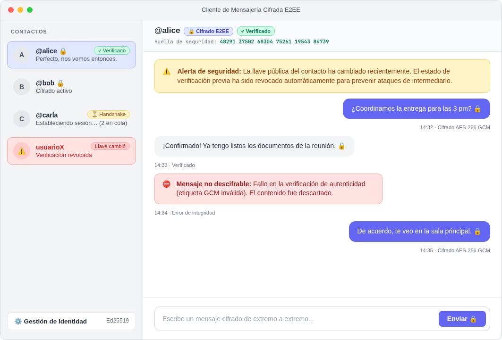
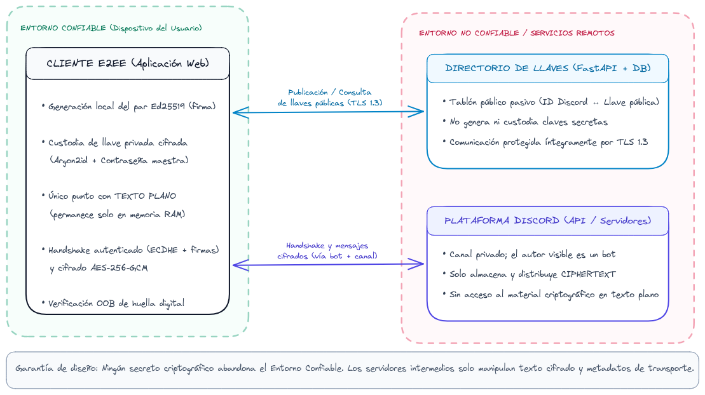
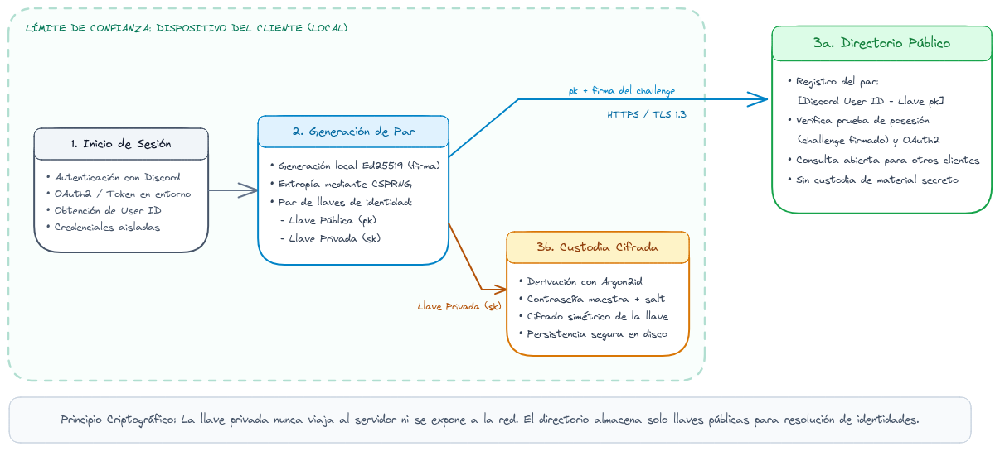
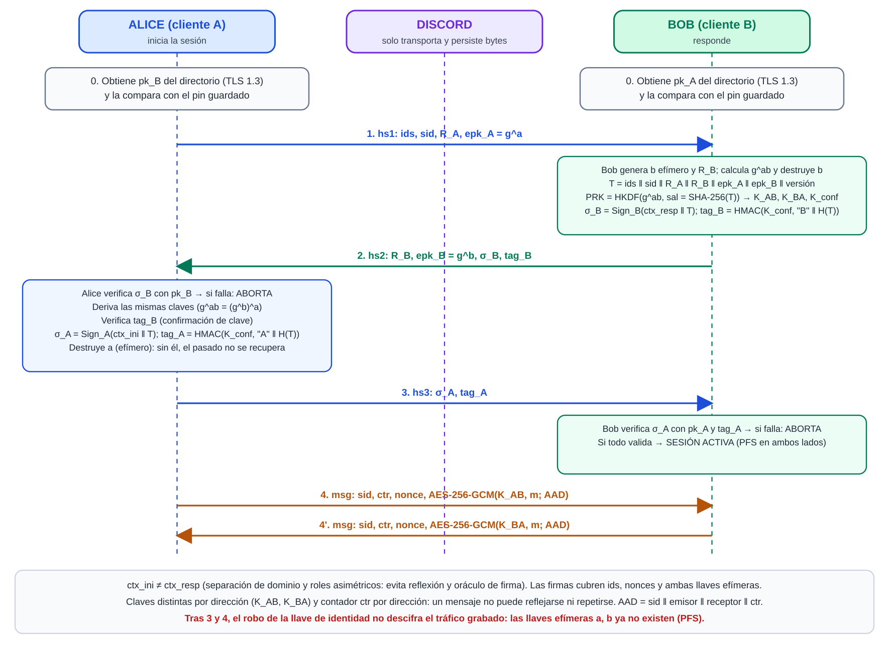
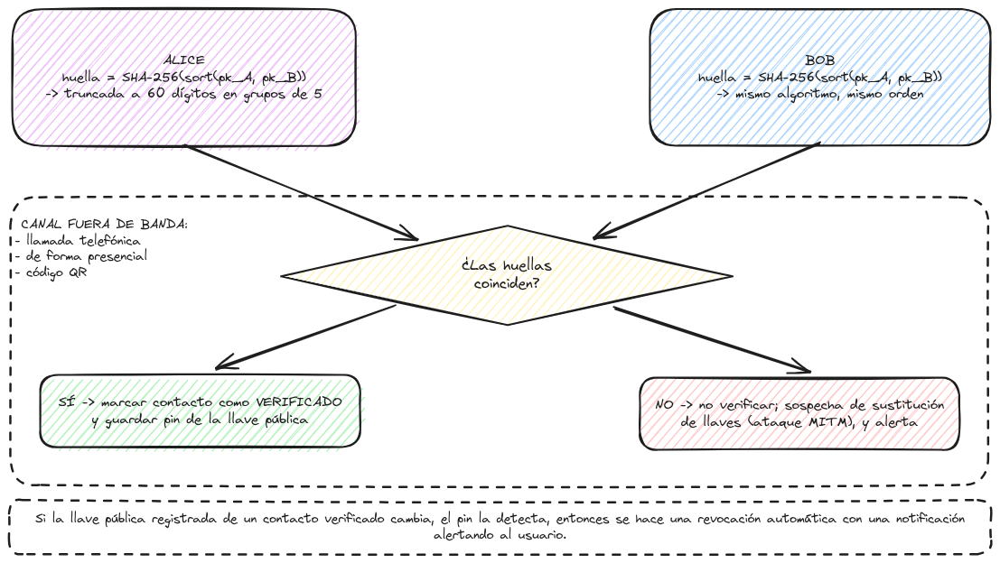

# Informe del Proyecto: Mensajería Cifrada en Discord

## 1. Motivación
En la actualidad, plataformas de comunicación masiva como Discord son utilizadas tanto para interacciones casuales como para coordinaciones profesionales y académicas. Sin embargo, Discord no ofrece cifrado de extremo a extremo (E2EE) por defecto para los mensajes directos o canales, lo que significa que la plataforma y sus servidores tienen acceso al contenido en texto plano de todas las comunicaciones. 

Este proyecto busca otorgar seguridad ante un problema observado en la vida real: la exposición de información confidencial (credenciales, propiedad intelectual, datos personales, etc) ante posibles brechas de datos en servidores de terceros o recolección masiva de datos. Al implementar una capa de cifrado sobre la API de Discord, garantizamos la confidencialidad e integridad de las conversaciones. De esta manera, las medidas de seguridad implementadas permiten al usuario hacer uso de su data y comunicarse a través de una plataforma popular sin sacrificar su derecho a la privacidad.

## 2. Trasfondo Teórico

Para comprender la arquitectura y las decisiones de seguridad de este proyecto, es fundamental definir los conceptos tecnológicos y criptográficos. Las tecnologías elegidas abordan directamente las vulnerabilidades de comunicaciones en red y aplican principios de seguridad defensiva.

* **Cifrado de Extremo a Extremo (E2EE):**
El E2EE es un paradigma de seguridad que garantiza que los mensajes permanezcan ininteligibles para cualquier entidad o proveedor de servicio, siendo descifrados exclusivamente por el emisor y el receptor previstos (Alatawi et al., 2023). En plataformas de mensajería estándar, el proveedor retiene el acceso al texto plano. Implementar E2EE permite resolver un problema observado en la vida real: la falta de privacidad en plataformas de terceros. Garantiza que los mensajes se encripten en el cliente antes de ser enviados al servidor para su transmisión, asegurando que ante cualquier fuga de datos en el servidor, los atacantes solo obtengan texto cifrado inservible (Park et al., 2023).

* **Criptografía Híbrida:**
Depender de un solo tipo de algoritmo es ineficiente para aplicaciones de mensajería. Por lo cual para este proyecto se va usar el esquema híbrido:

    * **Cifrado Simétrico (AES-GCM):** AES (Advanced Encryption Standard) es el estándar académico e industrial para cifrar el contenido del mensaje en sí, justificado por su altísima eficiencia computacional al procesar grandes volúmenes de datos (Garg et al., 2024). Se emplea la modalidad GCM (Galois/Counter Mode) porque proporciona simultáneamente confidencialidad e integridad, mitigando intentos de alteración del mensaje en tránsito.

    * **Criptografía de Llave Pública (ECC):** RSA y la Criptografía de Curva Elíptica (ECC) permiten establecer secretos y autenticar identidades sin un encuentro físico previo. ECC se prefiere sobre RSA por ofrecer un nivel de seguridad equivalente con llaves mucho menores. En el proyecto la criptografía asimétrica **no cifra el mensaje**: se usa para (i) **autenticar** a los interlocutores mediante firmas digitales **Ed25519** y (ii) acordar una clave simétrica de sesión mediante Diffie-Hellman sobre la curva **X25519** con llaves **efímeras**. Firmar y cifrar son operaciones distintas, por lo que cada par de llaves cumple un único propósito (separación de dominio).

* **Protocolos de autenticación y *Perfect Forward Secrecy* (PFS):**
Las primitivas seguras no garantizan un protocolo seguro: casi todos los ataques reales no rompen la criptografía, sino que usan al propio protocolo como herramienta. Para razonar sobre ello se adopta el modelo de Dolev y Yao (1983), en el que el atacante controla la red.

    * **La "trifecta":** un protocolo de establecimiento de sesión debe lograr simultáneamente (1) autenticación mutua, (2) una llave de sesión y (3) PFS, es decir, que el compromiso posterior de las llaves de largo plazo no comprometa las sesiones pasadas. Esta propiedad cobra relevancia por el ataque *harvest now, decrypt later*: un adversario guarda tráfico cifrado hoy y lo descifra cuando obtiene la llave. Este es el patrón de SSH (RFC 4253) y de TLS 1.3 (RFC 8446), que eliminó el intercambio con RSA estático precisamente porque robar esa llave descifraba todo el tráfico grabado.
    * **Lo que no es PFS:** cifrar con la llave pública *de larga vida* del receptor, aunque el emisor use una llave efímera, **no** otorga PFS para el receptor: quien obtenga su llave privada descifra todos los mensajes anteriores. Se necesita un valor efímero **en ambos extremos**, que se destruye al derivar la clave.
    * **Ataques al protocolo, no a la criptografía:** los ataques de *replay* (repetir un mensaje grabado), de *reflexión* (usar al otro extremo como oráculo de sus propios retos) y de oráculo de firma o descifrado se evitan con nonces frescos, roles asimétricos, identidades dentro de lo firmado (Abadi y Needham, 1996), llaves distintas por propósito y un contexto fijo en cada firma. El orden de operaciones también importa: firmar el cifrado sin incluir las identidades permite a un tercero reemplazar la firma (Davis, 2001).
    * **Cifrado autenticado y confirmación de clave:** como en TLS, el contenido se protege con un cifrado autenticado (AEAD) y el *handshake* termina con una confirmación de clave (MAC sobre la transcripción) que detecta cualquier alteración de la negociación (Krawczyk, 2003).

* **Discord API y OAuth**: Interfaces que permiten la interacción programática con la plataforma. Se requerirá el uso de OAuth o tokens de bot para hacer uso de la API y poder interceptar, enviar y leer mensajes.

* **Infraestructura y Manejo de Claves (Key Management):**
El manejo de llaves es el componente más crítico y vulnerable en cualquier sistema E2EE. La literatura advierte que, si un atacante compromete la infraestructura de distribución, la encriptación entera colapsa.

    * **El desafío (Vulnerabilidad Centralizada):** Tradicionalmente, se utiliza una Infraestructura de Clave Pública (PKI) basada en Autoridades Certificadoras (CA) centralizadas. Sin embargo, en E2EE, depender de un servidor centralizado administrado por un tercero para distribuir llaves públicas introduce un punto único de fallo (Park et al., 2023). Un servidor comprometido podría perpetrar un "ataque de sustitución de llaves", entregando la llave de un atacante en lugar de la del receptor legítimo (Alatawi et al., 2023).

    * **Alternativa:** Para evitar este riesgo, el diseño propone descentralizar la confianza. El servidor backend actuará únicamente como un directorio pasivo (un tablón de anuncios) para la distribución de llaves públicas **de firma**; las llaves de intercambio son efímeras y nunca se publican. Las llaves privadas nunca abandonarán el dispositivo; se asegurará que la data guardada permanezca en *plaintext* solo por un período corto de tiempo en memoria, y si se guarda en disco local, estará protegida mediante encriptación con una contraseña maestra.

* **Autenticación y Protección contra ataques Man-in-the-Middle (MitM):**
Para evitar el ataque de sustitución de llaves mencionado anteriormente, la criptografía por sí sola no es suficiente; se requiere certificar la identidad de los extremos.

    * **Autenticación Fuera de Banda (Out-of-Band - OOB):** Este es un requisito de diseño crítico para asegurar la integridad del E2EE. La autenticación OOB implica utilizar un canal secundario, completamente independiente al medio principal (Discord), para verificar las identidades (Naor et al., 2018).

    * **Implementación:** Siguiendo el estado del arte de aplicaciones como Signal o WhatsApp, los usuarios deberán someterse a una "Ceremonia de Autenticación" (Alatawi et al., 2023). Esto significa que la aplicación generará una huella digital (hash) criptográfica de la llave pública. Los usuarios deberán comparar este hash a través de una llamada telefónica, enviándolo por SMS, o escaneando un código QR en persona. Al corroborar que los hashes coinciden fuera de la red de Discord, se garantiza matemáticamente que ninguna entidad intermedia ha manipulado las llaves. Esto resuelve además el problema de *trust on first use* (TOFU) de SSH, donde casi nadie verifica la huella la primera vez.

## 3. Requerimientos

El proyecto tiene como fin crear una capa de seguridad en la comunicación de texto de **Discord**. Los requerimientos se derivan del siguiente modelo de amenaza.

**Modelo de amenaza**: Para el proveedor de la plataforma de **Discord** y cualquier entidad con acceso a sus servidores, se considera como adversario a un atacante pasivo y activo en la red. Se asume que es confiable el dispositivo del usuario y el sistema operativo del cliente. Queda **fuera del alcance** la protección de los metadatos, la disponibiliad del servicio y el compromiso físico del endpoint. El atacante activo puede además intervenir en el protocolo (repetir, reflejar, reordenar o suplantar mensajes del *handshake*), pero no puede romper las primitivas; y se asume que podría obtener **más adelante** la llave de identidad de un usuario, sin que eso deba exponer las conversaciones pasadas.

Para entender la distinción entre atacante pasivo y activo, se usa la definición de Dolev y Yao (1983) que menciona que la diferencia entre ambos es lo **qué puede hacer con los mensajes que ve**. El pasivo solo observa, lee, copia y almacena. En cambio, el activo puede modificar un mensaje, borrarlo, retrasarlo, reordenarlo, editarlo, etc.

Para enfocar esta distinción se ilustra esas diferencias bajo el trabajo realizado en la siguiente tabla.

| Actor | Atacante pasivo | Atacante activo |
|---    |---              |---              |
| **Discord / proveedor** | Lee el contenido de los DMs y canales; conserva el historial en sus bases de datos; lo entrega ante requerimiento legal o lo pierde en una brecha | Podría alterar mensajes en tránsito o inyectar contenido falso atribuido a un usuario |
| **Red** | Captura tráfico en una WiFi abierta o en un nodo intermedio | Se interpone en la conexión con el directorio de llaves y responde en su lugar |
| **Directorio de llaves** | Un volcado de su base de datos revela qué usuarios se registraron y cuándo| **Sustitución de llaves:** devuelve la llave pública del atacante en lugar de la del receptor legítimo |

### 3.1. Requerimientos Funcionales
* **RF1:** El sistema debe generar localmente, en el dispositivo del usuario, un par de llaves de identidad de firma (Ed25519) durante el registro inicial.

* **RF2:** El sistema debe publicar la llave del usuario en un directorio de llaves, permitiendo a otras personas obtener esa llave con el identificador de su cuenta de Discord.

* **RF3:** El sistema debe cifrar con una llave simétrica cada mensaje antes de ser enviado por la API de Discord.

* **RF4:** El sistema debe establecer una clave de sesión compartida con el destinatario mediante un intercambio Diffie-Hellman efímero autenticado con las llaves de identidad, de modo que solo ambos extremos puedan derivarla.

* **RF5:** El sistema debe detectar y descifrar automáticamente los mensajes entrantes dirigidos al usuario, mostrando el texto plano únicamente en la interfaz local.

* **RF6:** El sistema debe generar y mostrar una huella digital criptográfica derivada de las llaves públicas de ambos interlocutores.

* **RF7:** El usuario podrá marcar un contacto como _verificado_ tras completar el proceso de autentiación fuera del canal.

* **RF8:** El sistema debe notificar al usuario cuando la llave pública registrada de un contact ya _verificado_ cambie y revocar automaticamente su estado de verificación.

* **RF9:** El sistema debe indicar visualmente, por cada conversación, si el canal esta cifrado y si la contraparte está verificada.

* **RF10:** El sistema debe autenticarse frente a Discord mediante OAuth2 o token de bot, sin exponer esas credenciales en la interfaz.

* **RF11:** El sistema debe permitir identificar un mensaje que no se pueda descifrar.

* **RF12:** El usuario podra exportar e importar su identidad criptográfica para usarla en otro dispositivo , protegido por su contraseña maestra.

* **RF13:** El sistema debe autenticar a ambos interlocutores al establecer una sesión, verificando la firma del otro extremo contra la llave publicada en el directorio, y rechazarla si no coincide con la llave verificada (*pin*).

* **RF14:** El sistema debe mantener en cola los mensajes del usuario mientras la sesión no esté establecida, y enviarlos cifrados cuando el *handshake* termine.

### 3.2. Requerimientos de Seguridad

* **RS1:** La llave privada del usuario debe permanecer en el sistema y no ser transmitido a algun tercero.

* **RS2:** La llave privada en el dispositivo debe estar cifrada con una clave derivada de la contraseña maestra con **Argon2id** y con _salt_ unico por usaurio.

* **RS3:** El texto plano debe permanecer en memoria el menor tiempo posible y no debe escribirse ni en registros ni archivos temporales.

* **RS4:** Todo cifrado simétrico debe emplear AES-256 en modo GCM, con un _nonce_ de 96 bits generado por un CSPRNG del sistea operativo y jamás reutilizado bajo la misma clave.

* **RS5:** El sistema debe rechazar todo mensaje cuya etiqueta de autentiación GCM no se válida.

* **RS6:** La comunicación entre el cliente y el directorio de llaves debe realizarse sobre TLS 1.3, como defensa frente a un atacante en la red.

* **RS7:** El proceso de verificación de un usuario debe ser fuera del canal de Discord.

* **RS8:** La huella digital de verificación debe derivarse de las llaves públicas de ambas partes mediante una función hash (SHA-256), con un orden determinístico que produzca el mismo valor en ambos extremos.

* **RS9:** Las claves de sesión deben rotarse periódicamente (por número de mensajes y por tiempo) mediante un nuevo *handshake*, destruyendo las claves anteriores.

* **RS10:** Los tokens de acceso a la API de Discord deben gestionarse en variables de entorno.

* **RS11:** Todo el material criptográfico debe provenir de un generado de números aleatorios (pseudo-aleatorios) criptográficamente seguro.

* **RS12:** (*Perfect forward secrecy*) Las llaves Diffie-Hellman de sesión deben ser efímeras en ambos extremos y destruirse apenas se deriva la clave; el compromiso posterior de la llave de identidad no debe permitir descifrar sesiones pasadas.

* **RS13:** Toda firma del *handshake* debe cubrir las identidades de ambos interlocutores, los nonces, ambas llaves efímeras y la versión del protocolo, y debe llevar una cadena de contexto distinta según el rol (iniciador/respondedor). Toda sesión cuya firma o confirmación de clave no valide debe abortarse.

* **RS14:** El sistema debe rechazar mensajes repetidos, reordenados fuera de ventana o provenientes de otra sesión, mediante un contador por dirección y un identificador de sesión incluidos en los datos autenticados.

* **RS15:** Cada llave debe tener un único propósito: la llave de identidad solo firma; las llaves de sesión se derivan de forma independiente por dirección (emisor→receptor y receptor→emisor).

## 4. Diseño

El diseño se aborda desde dos aristas complementarias. El **diseño funcional** define la interfaz y la experiencia de usuario que materializa los requerimientos funcionales; el **diseño de seguridad** especifica los algoritmos y los protocolos que hacen cumplibles los requerimientos de seguridad.

### 4.1 Diseño funcional: interfaz y experiencia de usuario

El cliente se implementa como una página web independiente del cliente oficial de Discord. Para apoyar los requerimientos descritos previamente, la interfaz incorpora los siguientes indicadores de estado por conversación:

* **Candado cerrado:** la conversación tiene una sesión activa bajo el esquema descrito en 4.2.3 y 4.2.4. Mientras el *handshake* no termina, la conversación muestra "estableciendo sesión" y los mensajes quedan en cola (RF14).
* **Insignia de verificación:** la contraparte completó la autenticación fuera del canal de Discord.
* **Alerta de cambio de llave:** si la llave pública registrada de un contacto *verificado* cambia, el cliente revoca automáticamente la verificación y notifica al usuario.
* **Marcador "mensaje no descifrable":** se reserva para los mensajes entrantes que no pueden autenticarse o descifrarse.

El siguiente Wireframe ilustra una conversación con estos indicadores.

| Elemento de interfaz | Requerimientos |
|---    |---              |
| Indicador de cifrado (candado) y estado de sesión por conversación | RF3, RF9, RF13, RF14 |
| Insignia de contacto verificado | RF7, RF9 |
| Alerta y revocación automática de verificación | RF8 |
| Marcador "mensaje no descifrable" | RF11 |
| Vistas de autenticación, registro y gestión de identidad | RF1, RF2, RF10, RF12 |

### 4.2 Diseño de seguridad: algoritmos y protocolos

El diseño de seguridad sigue el patrón de SSH y TLS 1.3 clásico de SSH y TLS 1.3: **identidad de largo plazo para firmar, Diffie-Hellman efímero para la sesión y cifrado autenticado para los mensajes**. Combina Ed25519 (autenticación), X25519 (acuerdo de clave), HKDF-SHA256 (derivación) y AES-256-GCM (contenido). Cada llave cumple un único propósito. A continuación se describen los protocolos que implementan los requerimientos de seguridad.

> **Decisión de diseño.** No existe una llave Diffie-Hellman de larga vida: cifrar contra la llave pública de identidad del receptor no sería efímero para él, ya que robar su llave privada permitiría descifrar todo el historial. Por ello (i) la identidad es solo de firma, (ii) se usan llaves efímeras **en ambos extremos**, destruidas al derivar la clave (PFS), y (iii) ambos extremos se autentican con firmas sobre toda la transcripción del *handshake*.

#### 4.2.1 Arquitectura y límite de confianza

El sistema se compone de tres elementos: el **cliente**, único punto donde existe texto plano y material secreto; el **directorio de llaves**, tablón pasivo que asocia identificadores de Discord a llaves públicas de firma; y **Discord**, que transporta y persiste únicamente mensajes del protocolo y *ciphertext*. La comunicación entre el cliente y el directorio se protege con TLS 1.3 (RS6), neutralizando a un atacante activo en la red que intente interponerse en la descarga de llaves.

**Discord como canal de transporte.** La API oficial no permite enviar mensajes en nombre de un usuario (OAuth2 solo entrega su identidad), por lo que el cliente de cada persona usa un **bot** propio, con su token en variables de entorno (RS10), que publica y lee mensajes en un canal privado de un servidor de Discord creado para el proyecto. Como el autor de todos los mensajes que Discord muestra es un bot, **no se confía en el autor que reporta Discord**: el emisor y el receptor viajan dentro del mensaje (`from`, `to`) y se autentican mediante el *handshake* firmado y las claves por dirección. Cada cliente lee el canal, descarta los mensajes que no van dirigidos a su identificador y procesa el resto. Cualquier miembro del canal ve únicamente mensajes del protocolo (`hs1`, `hs2`, `hs3`) y ciphertext.

#### 4.2.2 Registro y custodia de la identidad

Durante el registro, el cliente genera el par de firma **Ed25519** en el dispositivo (RF1). La llave privada se cifra con una clave derivada de la contraseña maestra mediante **Argon2id** con *salt* único por usuario (RS2) y jamás abandona el dispositivo (RS1). La llave pública se publica en el directorio asociada al identificador de Discord (RF2) y el directorio nunca custodia material secreto. Para impedir que alguien registre una llave a nombre de otro, el directorio exige **prueba de posesión**: entrega un *nonce* y el cliente lo devuelve firmado junto con su identificador y la llave (`Sign(ctx_registro ‖ id ‖ pk ‖ nonce)`), mientras que el vínculo con la cuenta de Discord se comprueba con OAuth2. Un cambio posterior de llave debe firmarse con la llave anterior o repetir la autenticación OAuth2; en este último caso los contactos reciben la alerta de RF8.

#### 4.2.3 Establecimiento de sesión: *handshake* autenticado con PFS

Antes de intercambiar mensajes, dos usuarios establecen una sesión con tres mensajes enviados por Discord. Sea `T = ids ‖ sid ‖ R_A ‖ R_B ‖ epk_A ‖ epk_B ‖ versión` la transcripción, donde `R_A` y `R_B` son nonces de 256 bits, `sid` es un identificador de sesión y `epk` son las llaves públicas X25519 efímeras (`g^a`, `g^b`):

1. **hs1 (A→B).** A genera `a` y `R_A`, y envía `ids, sid, R_A, epk_A`. Antes, ambos extremos consultan la llave de firma del otro en el directorio por TLS 1.3 y la comparan con el *pin* si el contacto fue verificado (RF8).
2. **hs2 (B→A).** B genera `b` y `R_B`, calcula `g^ab`, deriva las claves (ver abajo) y **destruye `b`**, que ya no necesita. Responde `R_B, epk_B, σ_B, tag_B` con `σ_B = Sign_B(ctx_resp ‖ T)` y `tag_B = HMAC(K_conf, "B" ‖ SHA-256(T))`.
3. **hs3 (A→B).** A verifica `σ_B` con la llave de B y `tag_B`; **si alguno falla, aborta**. Calcula las mismas claves y responde `σ_A = Sign_A(ctx_ini ‖ T)` y `tag_A`. A **destruye `a`**.
4. **Activación.** B verifica `σ_A` y `tag_A` (si fallan, aborta). La sesión queda activa para ambos (RF13).

**Derivación.** `PRK = HKDF-Extract(sal = SHA-256(T), IKM = g^ab)`; luego `HKDF-Expand` produce tres llaves independientes: `K_AB` (A→B), `K_BA` (B→A) y `K_conf` (confirmación). Todo el material aleatorio proviene del CSPRNG del sistema operativo (RS11).

**Por qué este diseño resiste los ataques conocidos contra protocolos** (RS12, RS13, RS15):
* **Autenticación mutua:** cada extremo firma toda la transcripción con su llave de identidad; un atacante activo que reemplace `epk_A` o `epk_B` invalida las firmas.
* **PFS en ambos extremos:** `a` y `b` solo existen durante el *handshake*. Quien robe después la llave de identidad podrá suplantar al usuario en sesiones **futuras**, pero no recuperar `K_AB` ni `K_BA` de sesiones pasadas.
* **Reflexión y oráculo de firma:** los roles son asimétricos (`ctx_ini ≠ ctx_resp`), la identidad de quien firma y del destinatario está dentro de lo firmado y la llave de identidad solo firma datos con prefijo de contexto fijo; nunca firma un valor elegido por el otro extremo sin ese prefijo.
* **Degradación:** la versión viaja en `T`; no hay negociación de algoritmos (una sola suite), de modo que no existe un ataque de *downgrade*.
* **Confirmación de clave:** `tag_A` y `tag_B` prueban que ambos derivaron la misma clave a partir de la misma transcripción (análogo al `Finished` de TLS).
* **Frescura:** `R_A`, `R_B` y `sid` evitan el *replay* del *handshake*; un intento pendiente caduca a los 5 minutos y su llave efímera se destruye. Un `hs2` o `hs3` inválido se descarta sin cancelar el intento, de modo que un tercero con acceso al canal no puede impedir un *handshake* legítimo enviando mensajes falsos; solo el éxito o la caducidad lo cierran.

**Cola de salida y reintentos.** Los mensajes que el usuario escribe sin sesión activa esperan en una cola local, guardada en el almacén cifrado del dispositivo (RF14); no salen del dispositivo hasta que la sesión esté activa. Lo que caduca es el **intento** de *handshake*: si el otro extremo no responde, el cliente destruye su llave efímera y, de forma automática, inicia un intento nuevo (con `a`, `R_A` y `sid` nuevos) con espera creciente entre reintentos (15 min, 30 min, 60 min…), hasta un máximo de intentos, tras el cual la conversación muestra "contacto no disponible" y el usuario puede reintentar manualmente. El receptor ignora cualquier `hs1` cuya antigüedad supere la caducidad, por lo que un `hs1` viejo que aparezca al reconectarse no inicia una sesión.

#### 4.2.4 Protocolo de mensajería

Una vez activa la sesión, cada mensaje se protege con cifrado autenticado:

1. **Cifrado.** El emisor cifra con **AES-256-GCM** usando la llave de su dirección (`K_AB` o `K_BA`), un *nonce* de 96 bits del CSPRNG que jamás se reutiliza bajo la misma clave (RS4, RS11) y como datos autenticados adicionales (AAD) `sid ‖ emisor ‖ receptor ‖ ctr`, donde `ctr` es un contador por dirección (RF3).
2. **Transmisión.** Viaja por Discord `E2EE1:{sid, ctr, nonce, ciphertext+tag}`. Cada mensaje admite hasta 900 bytes de texto (el límite de Discord es de 2000 caracteres por mensaje); los textos más largos se dividen en varios mensajes.
3. **Recepción.** El receptor comprueba que `sid` corresponde a una sesión activa y que `ctr` no fue visto ni cae fuera de la ventana de recepción (RS14). Luego descifra **verificando la etiqueta GCM**; cualquier mensaje cuya etiqueta no valide es rechazado y marcado como no descifrable (RF5, RF11, RS5). El texto plano permanece en memoria el menor tiempo posible (RS3).

**Identidad del emisor.** Cada mensaje queda atribuido a su autor porque solo A y B conocen `K_AB` y `K_BA`, que se derivaron de un *handshake* en el que ambos demostraron su identidad con firmas. Esto es lo mismo que hacen SSH y TLS, que firman el *handshake* y no cada registro. No se firma cada mensaje por decisión de diseño: una firma por mensaje sería una prueba transferible a terceros (no repudio) que una conversación privada no necesita, y multiplicaría los usos de la llave de identidad. Las claves por dirección impiden además que un mensaje de A se refleje hacia A como si fuera de B.

#### 4.2.5 Rotación de claves y destrucción

Las sesiones se renuevan con un nuevo *handshake* después de un número máximo de mensajes (por defecto 100), de un tiempo máximo (por defecto 8 h) o a petición del usuario (RS9). Al activarse la nueva sesión, las claves anteriores se destruyen tras una breve ventana de gracia para mensajes en tránsito. Como consecuencia de la PFS, Discord conserva mensajes que ya nadie puede descifrar con las claves de sesión; por eso el cliente guarda el historial **ya descifrado** únicamente en un almacén local cifrado con AES-256-GCM bajo una clave derivada de la contraseña maestra (Argon2id), nunca en registros ni archivos temporales (RS3).

#### 4.2.6 Ceremonia de verificación

La ceremonia de verificación ofrece protección contra el ataque de sustitución de llaves en el directorio (RS7), que las firmas por sí solas no impiden, pues un directorio malicioso podría entregar una llave de identidad propia. Ambos extremos calculan la huella digital `SHA-256(pk_A || pk_B)` con las llaves de firma ordenadas lexicográficamente (RS8), presentada truncada a 60 dígitos decimales en grupos de cinco. Los usuarios comparan esas huellas **fuera del canal de Discord** (llamada, presencia o código QR). Solo entonces el cliente persiste el estado de *verificado* junto con un *pin* de la llave pública (RF7); si la llave cambia posteriormente, el *pin* permite detectar la discrepancia, revocar la verificación, **abortar el *handshake*** y alertar al usuario (RF8). El cliente no ofrece un botón de "continuar de todos modos" ante un cambio de llave.

#### 4.2.7 Análisis de ataques

Siguiendo el modelo de Dolev y Yao, se revisan los ataques considerados contra el protocolo:

| Ataque | Cómo se intenta | Defensa |
|---|---|---|
| Espionaje pasivo (Discord, red) | Leer o guardar mensajes y *handshakes* | AES-256-GCM; las claves se derivan de DH efímero, que no viaja |
| *Man-in-the-middle* en el *handshake* | Reemplazar `epk_A` o `epk_B` | Las firmas cubren ambas llaves efímeras y los ids (RS13) |
| Sustitución de llaves en el directorio | Devolver una llave de firma del atacante | TLS 1.3 con CA propia (RS6), ceremonia OOB y *pin* (RS7, RF8). **Riesgo residual:** un primer contacto no verificado es vulnerable, como el TOFU de SSH |
| *Replay* de *handshake* o de mensajes | Reenviar un mensaje grabado | Nonces `R_A`/`R_B`, `sid`, contador `ctr` y ventana (RS14); caducidad de sesiones pendientes |
| Reflexión | Usar a B como oráculo de sus propios mensajes | Roles asimétricos, ids firmados, claves por dirección (RS13, RS15) |
| Oráculo de firma o descifrado | Hacer que la víctima firme o descifre datos elegidos | La llave de identidad solo firma con prefijo de contexto; no se descifra nada fuera de una sesión (RS15) |
| Degradación | Forzar un algoritmo débil | Suite única; versión dentro de la transcripción firmada |
| Suplantación (*misbinding*) | Hacer que B crea hablar con otra persona | Los ids de ambos están dentro de la firma y del AAD |
| Compromiso posterior de la llave de identidad | Robarla y descifrar tráfico guardado | PFS: `a` y `b` destruidas (RS12). No protege sesiones **futuras** ni un dispositivo ya comprometido (fuera de alcance) |
| Alteración o inyección de mensajes | Modificar o falsificar el ciphertext | Etiqueta GCM con AAD (RS5) |
| Eliminación o reordenamiento por Discord | Borrar o reordenar mensajes | Los huecos y el desorden se detectan por `ctr`; la disponibilidad queda fuera de alcance |

## 5. Implementación Propuesta

### 5.1 Arquitectura general

El proyecto se compone de tres elementos. El **cliente** concentra toda la lógica criptográfica y es el único punto donde existe el _plain text_. El **directorio de llaves** es un servicio propio que va a almacenar los pares (identificador **Discord** -> llave pública). Por último **Discord**, actúa exclusivamente como una capa de transporte de los mesnajes y la persistencia de estos, a través de un bot y un canal privado.

### 5.2 Esquema criptográfico concreto

| Elemento | Algoritmo / parámetro |
|---|---|
| Identidad (autenticación) | Ed25519, un par por usuario, generado en el dispositivo |
| Acuerdo de clave | X25519, par **efímero** por sesión en cada extremo, destruido tras derivar la clave |
| Derivación | HKDF-SHA256 con sal `SHA-256(T)`; salidas independientes `K_AB`, `K_BA`, `K_conf` |
| Confirmación de clave | HMAC-SHA256 con `K_conf` sobre `SHA-256(T)` |
| Cifrado de mensajes | AES-256-GCM, *nonce* de 96 bits del CSPRNG, AAD = `sid ‖ emisor ‖ receptor ‖ ctr` |
| Custodia de la identidad | Argon2id + *salt* único; AES-256-GCM sobre la llave privada |
| Huella de verificación | SHA-256 sobre las llaves de firma ordenadas, 60 dígitos |
| Rotación | Nuevo *handshake* cada 100 mensajes o 8 h; ventana de gracia breve |

1. Cada usuario posee una llave de identidad **Ed25519**, que solo firma.
2. Para iniciar una sesión, cada extremo genera un par efímero X25519 y ambos intercambian `epk`, nonces e identificadores.
3. Cada extremo firma la transcripción completa con su llave de identidad y verifica la del otro; ambos se confirman la clave con un MAC.
4. Del secreto Diffie-Hellman se derivan, por HKDF-SHA256, una clave AES-256 distinta para cada dirección.
5. Los mensajes se cifran con AES-256-GCM con el contador y el identificador de sesión como datos autenticados.
6. Las llaves efímeras se destruyen al derivar la clave, de modo que el compromiso posterior de la llave de identidad no permite descifrar sesiones pasadas.

### 5.3 Proceso de verificación

La huella digital se calcula como `SHA-256(pk_A || pk_B)` con las llaves de firma ordenadas lexicográficamente, y se presenta truncada a 60 dígitos decimales en grupos de cinco, siguiendo el patrón de los _safety numbers_ de Signal.
Luego los usuarios la comparan por llamada telefónica, presencialmente o escaneando el QR del otro dispositivo. Solo entonces el cliente persiste el estado de "verificado" junto con un _pin_ de la llave pública, que habilita la alerta de RF8.

### 5.4 Tecnologías

* **Cliente:** Python 3.12 con `discord.py` para la API y la biblioteca `cryptography`.

* **Derivación de contraseña maestra:** `argon2-cffi`

* **Interfaz:** Pagina web idependeinte al cliente oficial de Discord

* **Directorio de llaves:** FastAPI + PostgreSQL.

* **Control de secretos y versiones:** Git con `.env` excluido y variables de entorno en despliegue.

### 5.5 Fases de ejecución

1. **Núcleo criptográfico aislado:** Implementar el *handshake* autenticado, la derivación de claves y el cifrado/descifrado, con pruebas de los caminos de rechazo (firma, confirmación de clave y etiqueta GCM inválidas, *replay*).

2. **Almacén local de identidad:** Generación de llaves, cifrado con contraseña maestra, exportación e importación.

3. **Dirección de llaves:** Servicio, esquema de datos y cliente HTTPS.

4. **Integración con Discord:** Envío y recepción de mensajes.

5. **Proceso de verificación:** Huellas digirales, QR, indicadores de estado y alertas de cambio de clave.

### 5.6 Limitaciones reconocidas

El sistema protege el contenido, no el patrón de comunicación que se realiza a través de la API de **Discord**. Además:

* Las conversaciones son entre dos personas; no hay mensajes de grupo. Los participantes de un mismo canal pueden ver quién se comunica con quién y cuándo (metadatos).
* El *handshake* es interactivo: ambos usuarios deben estar conectados para establecer una sesión. Mientras tanto los mensajes esperan en una cola local cifrada (RF14) y no se pierden si el usuario cierra la aplicación. Los reintentos solo se ejecutan con la aplicación abierta y se retoman con un *handshake* nuevo al reabrirla, porque la llave efímera del intento pendiente nunca se guarda en disco, a fin de no comprometer la PFS.
* La PFS implica que Discord guarda mensajes que las claves de sesión ya no pueden descifrar; por eso el historial se conserva descifrado en un almacén local cifrado.
* Un primer contacto no verificado depende de la confianza en el directorio (TOFU); la ceremonia OOB lo corrige.
* No hay seguridad posterior al compromiso dentro de una sesión (*post-compromise security*) ni *ratchet* por mensaje; la rotación periódica limita el daño.
* No se firma cada mensaje, por lo que no hay no repudio.
 
## 6. Privacidad y ética

### 6.1 Evaluación de impacto en la protección de datos (DPIA)

Antes de que entre un solo dato real, se evaluó el sistema con la plantilla de siete pasos de las autoridades de protección de datos (necesidad de la evaluación, descripción del tratamiento, consulta, necesidad y proporcionalidad, riesgos, medidas y aprobación), adaptada a la Ley 29733 y su reglamento. El documento completo es [la DPIA](dpia/DPIA.md); esta sección resume sus resultados.

**Qué datos se tratan.** El directorio guarda únicamente el ID de Discord, la llave pública de firma, las fechas de registro y la versión del aviso de privacidad aceptado. El contenido de los mensajes y las llaves privadas nunca salen del dispositivo: Discord solo almacena texto cifrado, aunque sí puede observar los **metadatos** (quién, a quién y cuándo).

**Riesgos identificados.** Se evaluaron 13 riesgos, recorriendo el ciclo de vida del dato y las categorías LINDDUN, con la probabilidad y la gravedad de cada uno:

| ID | Riesgo | Riesgo inicial | Riesgo residual |
|---|---|---|---|
| R1 | Exposición de metadatos a Discord y al canal | Alto | Medio (aceptado) |
| R2 | Sustitución de llaves por un directorio malicioso | Alto | Medio (aceptado) |
| R3 | Robo o infección del dispositivo | Alto | Medio (aceptado) |
| R4 | Contraseña maestra débil o perdida | Medio | Bajo |
| R5 | Brecha de la base de datos del directorio | Medio | Bajo |
| R6 | Conservación excesiva o borrado incompleto | Alto | Bajo |
| R7 | Falta de transparencia hacia las personas | Alto | Bajo |
| R8 | Datos personales en los registros del servicio | Medio | Bajo |
| R9 | Incumplimiento legal (banco de datos, transferencias, notificación) | Medio | Bajo |
| R10 | Filtración del token del bot | Medio | Bajo |
| R11 | Robo de la llave de identidad | Alto | Medio (aceptado) |
| R12 | Personas menores de edad | Medio | Bajo |
| R13 | Defecto del protocolo, sin auditoría externa | Alto | Medio (aceptado) |

**Medidas.** Cada riesgo se mitiga con restricciones verificables (24 en total), cada una con la prueba, archivo o revisión que la comprueba, su responsable y su estado real. Entre ellas: cifrado de extremo a extremo y *forward secrecy* (R1, R3, R13), verificación fuera de banda con *pin* de llaves (R2, R11), cifrado en reposo con Argon2id y bloqueo temporal tras intentos fallidos (R3, R4), esquema mínimo del directorio, TLS 1.3 con CA propia, registros sin datos personales y plazos de retención con borrado (R5, R6, R8), y consentimiento por versión con aviso de privacidad (R7, R12).

**Decisión.** Ningún riesgo residual es alto, por lo que no se requiere consulta previa a la autoridad. El sistema **puede lanzarse con condiciones**: la demostración local puede usar lo ya implementado, pero **no debe usarse con datos reales de terceros** mientras estén pendientes las restricciones del servicio de directorio, el plan de incidentes y el análisis de código. Los cinco riesgos que quedan en nivel medio se aceptan de forma explícita en la DPIA, con sus razones. La DPIA es un documento vivo y se revisa ante cualquier cambio de datos, finalidad, tecnología o proveedor.

### 6.2 Cumplimiento de la Ley 29733 y su reglamento

El sistema se construye en Perú y trata datos personales de personas identificables (el ID de Discord y su llave), por lo que le aplican la Ley N.° 29733 de Protección de Datos Personales y su reglamento (DS 016-2024-JUS). Si en el futuro participaran personas ubicadas en la Unión Europea a las que se les ofrezca el servicio, también podría aplicar el GDPR (art. 3.2): hoy no se dirige a ese público y habría que revisarlo antes de abrirlo. Lo que sigue no es asesoría legal; el texto vigente debe verificarse antes de un uso real.

**Principios.** Cada uno de los ocho principios de la ley se traduce en una decisión de diseño:

| Principio | Cómo se cumple |
|---|---|
| Legalidad | Los datos los entrega la propia persona al registrarse; no se obtienen por otros medios ni de otras fuentes |
| Consentimiento (libre, previo, expreso, informado, inequívoco) | Casilla desmarcada, finalidad única y versión del aviso registrada; el aviso completo se muestra antes de aceptar. Un cambio del aviso exige aceptarlo de nuevo |
| Finalidad | Dos finalidades explícitas: que otras personas encuentren la llave y que puedan verificarse entre sí. Nada de publicidad ni análisis |
| Proporcionalidad | El directorio guarda solo ID, llave pública, fechas y versión del aviso. No hay nombre, correo, teléfono, foto, nombre de usuario ni IP |
| Calidad | Plazos de conservación definidos para cada dato; la persona corrige su llave cuando cambia |
| Seguridad | Cifrado de extremo a extremo, cifrado en reposo, control de acceso mínimo, registros de auditoría y plan de incidentes (secciones 4 y 6.1) |
| Disposición de recurso | Contacto para ejercer derechos y vía de reclamo ante la autoridad (ANPD), indicados en el aviso |
| Nivel de protección adecuado | A Discord, en Estados Unidos, solo viajan texto cifrado y metadatos; el contenido no puede leerse allí |

**Derechos del titular.** El aviso informa y la aplicación facilita el ejercicio de los derechos de acceso, rectificación, cancelación y oposición, además de la portabilidad (exportar la identidad cifrada) y la información. No hay decisiones automatizadas sobre las personas. El detalle y el estado de cada derecho están en la DPIA.

**Obligaciones del responsable:**

| Obligación | Situación |
|---|---|
| Aviso de privacidad con lo que la ley exige informar (responsable y domicilio, finalidad, destinatarios, carácter obligatorio u opcional, transferencias, plazos, banco de datos, derechos) | Hecho: [aviso de privacidad](privacidad/aviso-de-privacidad.md) v1.0, publicado también dentro de la aplicación. El domicilio postal y un correo del equipo se completarán antes de un uso real |
| Medidas de seguridad proporcionales al riesgo (cifrado, control de acceso por roles, registros de auditoría, plan de respuesta a incidentes) | En curso; ver las restricciones C-01 a C-20 de la DPIA |
| Notificar una brecha a la ANPD dentro de las 48 horas desde que se conoce, y a las personas afectadas si el impacto es alto | Plan de incidentes pendiente (restricción C-19) |
| Inscribir el banco de datos en el Registro Nacional de Protección de Datos Personales | Pendiente: la demostración es académica; se evaluará antes de un uso real (C-24) |
| Oficial de datos personales | Obligatorio para entidades públicas y para quien trata datos sensibles o a gran escala. El responsable no puede leer los mensajes y el volumen es pequeño, por lo que no se prevé; se designa una persona de contacto y se revisará si el uso crece |
| Evaluación de impacto | Hecha de forma voluntaria (sección 6.1); además de ser buena práctica, es un atenuante si llegara una sanción |

La práctica sancionadora en Perú castiga sobre todo faltas de proporcionalidad, consentimiento y finalidad, más que fallas criptográficas. Por eso el diseño empieza por no recolectar lo que no se necesita.

### 6.3 Consideraciones éticas

**No hay acceso excepcional ni llave de custodia.** Es la decisión ética central del proyecto. Una llave que permita a una autoridad (o al operador) leer conversaciones es, por definición, una llave de larga vida que anula la *forward secrecy* y que tarde o temprano se filtra, se roba o se usa mal (Abelson et al., 2015). Quien pierde la confianza en el sistema no es solo el sospechoso, sino todas las personas usuarias. El costo de esta decisión es real y se asume: ante una orden válida solo podemos entregar lo que tenemos (ID, llave pública y fechas), nunca el contenido, y no podemos ayudar a investigar un delito que ocurra dentro de una conversación. El aviso lo dice con claridad.

**Quién controla las llaves.** Solo la persona usuaria. La contrapartida es que **no hay recuperación de contraseña**: olvidarla significa perder la identidad y el historial. Se prefirió esa carga a la alternativa (guardar un respaldo de la llave en un servidor), que reintroduciría al operador como un punto capaz de leer los mensajes. Para reducir el daño se ofrece exportar la identidad cifrada y se advierte de forma explícita.

**El directorio concentra confianza.** Quien opera el directorio podría entregar una llave falsa. Tiene por eso obligaciones concretas: guardar lo mínimo, no registrar direcciones IP, dejar rastro de cada cambio de llave para que los clientes puedan detectarlo, conservar los datos solo el tiempo definido, notificar las brechas y no sustituir ninguna llave. Lo que no puede evitarse con reglas se limita con diseño: la ceremonia de verificación fuera de banda permite a las personas comprobar que el directorio no las engaña.

**Advertencias sin botón de "continuar".** Ante un cambio de llave de un contacto verificado, la aplicación no ofrece seguir de todos modos: obliga a repetir la verificación. Es una decisión algo paternalista, pero está respaldada por la evidencia: en estudios de campo, entre un tercio y siete de cada diez personas ignoraron las advertencias de certificado que sí permitían continuar (Akhawe & Felt, 2013). Se prefiere proteger por defecto antes que confiar en que cada persona sepa evaluar el riesgo.

**Abuso y moderación.** El cifrado de extremo a extremo protege por igual a quien conversa en privado y a quien acosa o comete un delito; el operador no puede moderar lo que no puede leer. El sistema no pretende resolver esto: cada persona conserva las herramientas de Discord para bloquear o silenciar, y puede denunciar mostrando voluntariamente lo que recibió. Se deja como recomendación futura un mecanismo de denuncia verificable que no rompa el cifrado.

**Menores y accesibilidad.** Discord admite usuarios de 13 años o más y la aplicación no verifica la edad: pedir un documento obligaría a recoger más datos de los necesarios. En su lugar, el aviso está dirigido a mayores de edad y el consentimiento incluye una declaración de mayoría de edad; antes de un uso real habrá que fijar una edad mínima. La comparación de una huella de 60 dígitos puede ser difícil para algunas personas; el código QR y la lectura por grupos de cinco dígitos son las vías previstas.

**Respeto a la plataforma y a terceros.** Se usa únicamente la API oficial de Discord con bots, nunca el token de la cuenta de una persona. Las conversaciones ocurren en un canal privado creado para el proyecto. Los contactos que cada persona guarda en su dispositivo no salen de él; el directorio solo contiene a quienes se registraron y aceptaron el aviso.

---

### Referencias Bibliográficas

* Park, Y., Yoo, H., Ryu, J., Choi, Y.-R., Kang, J.-S., & Yeom, Y. (2023). End-to-end post-quantum cryptography encryption protocol for video conferencing system based on government public key infrastructure. Applied System Innovation. https://doi.org/10.3390/asi6040066

* Garg, P., Gupta, A., Singh, Y. P., & Goyal, P. (2026). End-to-end encryption: Evolution, barriers, and emerging trends. https://doi.org/10.1007/978-981-95-1683-4_8

* Alatawi, M., & Saxena, N. (2023). SoK: An analysis of end-to-end encryption and authentication ceremonies in secure messaging systems. En Proceedings of the 16th ACM Conference on Security and Privacy in Wireless and Mobile Networks (pp. 187–201). ACM. https://doi.org/10.1145/3558482.3581773 

* Naor, M., Rotem, L., & Segev, G. (2018). The security of lazy users in out-of-band authentication (IACR Cryptology ePrint 2018/823). IACR. https://eprint.iacr.org/2018/823

* Abadi, M., & Needham, R. (1996). Prudent engineering practice for cryptographic protocols. IEEE Transactions on Software Engineering, 22(1), 6–15. https://doi.org/10.1109/32.481513

* Davis, D. (2001). Defective sign & encrypt in S/MIME, PKCS#7, MOSS, PEM, PGP, and XML. En Proceedings of the USENIX Annual Technical Conference.

* Krawczyk, H. (2003). SIGMA: The "SIGn-and-MAc" approach to authenticated Diffie-Hellman and its use in the IKE protocols. En CRYPTO 2003 (LNCS 2729, pp. 400–425). Springer.

* Rescorla, E. (2018). The Transport Layer Security (TLS) Protocol Version 1.3 (RFC 8446). IETF. https://www.rfc-editor.org/rfc/rfc8446

* Ylonen, T., & Lonvick, C. (2006). The Secure Shell (SSH) Transport Layer Protocol (RFC 4253). IETF. https://www.rfc-editor.org/rfc/rfc4253

* Krawczyk, H., & Eronen, P. (2010). HMAC-based Extract-and-Expand Key Derivation Function (HKDF) (RFC 5869). IETF. https://www.rfc-editor.org/rfc/rfc5869

* Langley, A., Hamburg, M., & Turner, S. (2016). Elliptic Curves for Security (RFC 7748). IETF. https://www.rfc-editor.org/rfc/rfc7748

* Josefsson, S., & Liusvaara, I. (2017). Edwards-Curve Digital Signature Algorithm (EdDSA) (RFC 8032). IETF. https://www.rfc-editor.org/rfc/rfc8032

* Deng, M., Wuyts, K., Scandariato, R., Preneel, B., & Joosen, W. (2011). A privacy threat analysis framework: supporting the elicitation and fulfillment of privacy requirements. Requirements Engineering, 16(1), 3–32. https://doi.org/10.1007/s00766-010-0115-7

* Abelson, H., Anderson, R., Bellovin, S. M., Benaloh, J., Blaze, M., Diffie, W., Gilmore, J., Green, M., Landau, S., Neumann, P. G., Rivest, R. L., Schiller, J. I., Schneier, B., Specter, M., & Weitzner, D. J. (2015). Keys under doormats: mandating insecurity by requiring government access to all data and communications. Journal of Cybersecurity, 1(1), 69–79. https://doi.org/10.1093/cybsec/tyv009

* Akhawe, D., & Felt, A. P. (2013). Alice in Warningland: a large-scale field study of browser security warning effectiveness. En Proceedings of the 22nd USENIX Security Symposium (pp. 257–272).

* Cavoukian, A. (2009). Privacy by Design: The 7 Foundational Principles. Information and Privacy Commissioner of Ontario.

* Congreso de la República del Perú (2011). Ley N.° 29733, Ley de Protección de Datos Personales; y su reglamento, Decreto Supremo N.° 016-2024-JUS.

* * Dolev, D., & Yao, A. C. (1983). On the security of public key protocols. IEEE Transactions on Information Theory, 29(2), 198–208. https://doi.org/10.1109/TIT.1983.1056650