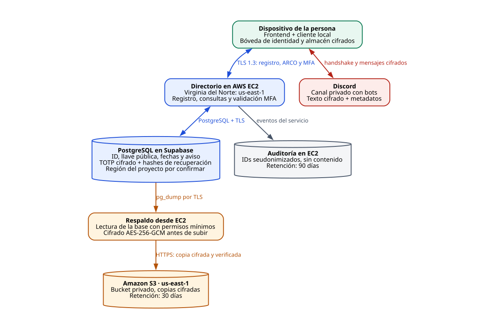

# Evaluación de Impacto en la Protección de Datos (DPIA)

**Sistema:** mensajería cifrada de extremo a extremo sobre Discord
**Versión:** 1.2 (pendiente de firma) · **Elaborada:** 2026-10-25 · **Actualizada:** 2026-11-14 · **Formato:** plantilla de 7 pasos (ICO), adaptada a la Ley 29733 y su reglamento (DS 016-2024-JUS)

> **Estado de las medidas.** Se distingue entre implementación comprobable en el repositorio y configuración del entorno desplegado. Una prueba local no acredita que la misma medida esté activada en EC2. El equipo debe revisar las evidencias operativas, el simulacro y los riesgos residuales antes de firmar la evaluación.

## Datos del responsable

| | |
|---|---|
| Responsable del tratamiento | Equipo del proyecto: Elmer Villegas Suarez y Farid Aquino Castro |
| Delegado / oficial de datos | No designado. Ambos integrantes realizan la revisión interna; esto no sustituye el cargo de oficial de datos personales cuando corresponda |
| Contacto para ejercer derechos | [elmer.villegas@utec.edu.pe](mailto:elmer.villegas@utec.edu.pe) y [farid.aquino@utec.edu.pe](mailto:farid.aquino@utec.edu.pe) |

---

## Paso 1. Necesidad de una DPIA

**Qué hace el proyecto.** Una capa de cifrado de extremo a extremo (E2EE) sobre la API de Discord. Cada persona usa un frontend conectado a un cliente local que cifra los mensajes antes de enviarlos. Discord recibe el texto cifrado y los metadatos del protocolo. Un *directorio de llaves* publica, por cada usuario, su ID de Discord y su llave pública de firma para que otros puedan encontrarla.

**Por qué se hace una DPIA.** Se realiza de forma preventiva en el alcance académico porque se cumplen varios de los factores que la hacen recomendable:

1. **Tecnología novedosa:** un protocolo criptográfico propio (handshake autenticado con PFS) que no ha tenido una auditoría externa.
2. **Puede alcanzar datos sensibles:** el contenido de las conversaciones es libre y puede incluir datos de salud, políticos, de menores, etc., aunque el responsable no puede leerlos.
3. **Identificadores de personas reales:** el directorio relaciona un ID de Discord con una llave y una fecha.
4. **Privacidad desde el diseño:** conviene identificar los riesgos antes de que entre un solo dato real.

---

## Paso 2. Descripción del tratamiento

### 2.1 Naturaleza: cómo se recogen, usan, guardan y borran los datos

El directorio está desplegado en Amazon EC2, en Virginia del Norte, Estados Unidos (`us-east-1`). PostgreSQL corre en un contenedor dentro de esa misma instancia. El cliente y el frontend siguen en el dispositivo de cada persona. El MFA del registro y del desbloqueo habitual está desplegado y probado con Microsoft Authenticator, según la confirmación del equipo. El destino de las copias de seguridad queda pendiente de confirmar en el inventario de alojamiento.

| Etapa | Qué ocurre | Dónde |
|---|---|---|
| **Recolección** | La persona escribe su ID de Discord y acepta el aviso de privacidad. El dispositivo genera la llave de identidad; solo la llave **pública** y el ID se publican. OAuth2 y TOTP autorizan el registro; el secreto del factor se guarda cifrado y los códigos de recuperación como hashes. | Dispositivo -> directorio |
| **Almacenamiento** | Llave privada y datos locales: cifrados con AES-256-GCM bajo una clave derivada de la contraseña maestra (Argon2id). Directorio: base de datos con ID, llave pública y fechas. Discord: ciphertext. | Dispositivo; directorio; Discord |
| **Uso** | Cifrar, firmar y descifrar mensajes y verificar contactos en el dispositivo. El directorio valida la firma de desbloqueo y el TOTP antes de que el cliente abra el historial. | Dispositivo; directorio para autenticación |
| **Compartición** | Con otros usuarios (llave pública, por diseño) y con Discord (ciphertext y metadatos, por necesidad técnica). El proveedor del alojamiento del directorio también procesa los datos necesarios para prestar ese servicio; la base PostgreSQL comparte la instancia en `us-east-1` y el destino de los respaldos queda por confirmar. | No aplica |
| **Destrucción** | Llaves de sesión y llaves efímeras: se destruyen al rotar o bloquear. El resto, según la tabla de retención (2.2). | Dispositivo; directorio |

**Fuentes de datos:** la propia persona (ID, mensajes) y el dispositivo (llaves generadas). El ID de Discord se vincula con su cuenta mediante OAuth2 (`identify`), sin pedir nada más.

**Tratamientos de riesgo alto presentes:** tecnología novedosa (protocolo propio sin auditoría externa). **No hay** perfilado, decisiones automatizadas, seguimiento de comportamiento ni vigilancia sistemática.

### 2.2 Alcance: qué datos, cuántos, cuánto tiempo

| Dato | Dónde está | Sensibilidad | Quién lo puede ver | Retención |
|---|---|---|---|---|
| ID de Discord | Directorio; contactos locales; campos `from`/`to` de cada mensaje; logs (seudonimizado) | Personal (identificador) | Directorio, Discord y miembros del canal | Hasta que la persona cancele su registro |
| Llave pública de firma | Directorio; contactos locales | Pública por diseño | Cualquier usuario | Igual que el ID. Llaves reemplazadas: 90 días |
| Fechas de registro y de cambio de llave | Directorio | Personal (metadato) | Operadores del directorio | Igual que el registro |
| Versión del aviso aceptado y fecha | Directorio; almacén local | Personal (prueba de consentimiento) | Operadores; la propia persona | Mientras dure el registro; la auditoría se conserva seudonimizada durante 90 días |
| Secreto TOTP cifrado, hashes de recuperación y estado de autenticación | Directorio; secreto también en la app autenticadora | Crítica (autenticación) | Backend con clave de cifrado independiente; metadatos accesibles a la persona | Hasta cancelar el registro o reemplazar el factor; altas sin confirmar: un día; sesiones de vinculación: cinco minutos, con purga diaria; desafío de desbloqueo: 120 segundos |
| Contenido de los mensajes (texto plano) | **Solo** el dispositivo: memoria y almacén local cifrado | **Potencialmente sensible**; el responsable no puede leerlo | Solo los dos interlocutores | Hasta que la persona lo borre localmente |
| Mensajes cifrados | Discord | Ilegible sin las llaves de sesión, que ya no existen tras rotar o bloquear | Discord y miembros del canal | Según Discord (fuera de nuestro control) |
| Metadatos de mensajes (quién, a quién, cuándo, tamaño) | Discord; canal | Personal (relaciones sociales) | Discord y miembros del canal | Según Discord |
| Llave privada y `store_key` | Solo el dispositivo, en `vault.json` cifrado | Crítica | Nadie sin la contraseña maestra | Hasta que la persona borre la bóveda |
| Alias y pines de los contactos, historial, cola de salida | Almacén local cifrado (`store.enc`) | Personal | Solo la persona | Hasta que la persona los borre |
| Registros de auditoría | Servidor del directorio | Personal (ID seudonimizado) | Operadores | 90 días |
| Copias de seguridad del directorio | Fuera del servidor, cifradas | Igual que el directorio | Operadores | Rotación de 30 días |

**Por qué estos plazos.** Cada dato se conserva solo mientras sirve a su finalidad (limitación del plazo de conservación):

* **Registro del directorio, hasta que la persona lo cancele.** Su base es el consentimiento; sin él no hay razón para conservarlo.
* **Registros de auditoría, 90 días.** Un incidente suele detectarse semanas después de ocurrir; ese tiempo permite investigarlo y reunir la evidencia que pide la notificación a la autoridad (48 horas desde que se conoce). Más allá no hay finalidad que lo justifique.
* **Llaves reemplazadas, 90 días.** Permiten explicar y revisar un cambio de llave sospechoso; después no aportan nada.
* **Copias de seguridad, 30 días con rotación.** Equilibran poder recuperarse de un desastre o ataque con que una cancelación quede completa, también en las copias, en un mes. Una copia más antigua sobreviviría al borrado.
* **Autenticación:** el factor confirmado se conserva hasta cancelar el registro o reemplazarlo. El estado de vinculación sin confirmar se purga tras un día; las sesiones web vencen a los cinco minutos y los desafíos firmados a los 120 segundos. La sesión local real dura 30 minutos por defecto y no se persiste como autorización para un próximo desbloqueo. Estos plazos son distintos de la retención de datos.
* **Contenido local:** lo decide la persona, porque solo existe en su dispositivo.

Estos plazos están definidos en el código y en las políticas. Falta comprobar su programación y ejecución en el entorno alojado; se revisan si cambia la finalidad.

**Categorías especiales:** el sistema no las recoge ni puede leerlas; solo podrían aparecer dentro de los mensajes, que solo ven las personas que conversan.
**Volumen y frecuencia:** demostración con 2 usuarios; uso real previsto de decenas. Un registro por persona; los mensajes dependen de ellas.
**Personas afectadas:** usuarios de la aplicación y sus contactos (que solo se publican mediante registro con OAuth2, prueba de posesión y consentimiento: ver R7).
**Área geográfica:** Participantes del proyecto en Perú. Discord trata datos en su infraestructura internacional. El directorio y PostgreSQL se alojan en la misma instancia AWS EC2, en Virginia del Norte, Estados Unidos (`us-east-1`). Queda pendiente confirmar el destino de las copias de seguridad.

### 2.3 Contexto

* **Relación con las personas:** directa y voluntaria; el equipo no tiene ningún vínculo de autoridad sobre ellas.
* **Control que tienen:** crean y bloquean su identidad, exportan su identidad cifrada, verifican contactos, deciden con quién hablan. Pueden borrar su registro del directorio con el endpoint de cancelación (C-11).
* **Expectativas:** quien usa una herramienta "cifrada" espera que nadie lea sus mensajes; no necesariamente que los **metadatos** queden visibles (ver R1). Por eso el aviso lo dice explícitamente.
* **Menores y grupos vulnerables:** La aplicación está dirigida a mayores de edad. El frontend exige declarar esa condición al aceptar el aviso, pero no comprueba edad con documentos ni fecha de nacimiento (ver R12).
* **Inquietudes previas:** el debate público sobre el acceso excepcional frente al E2EE; el proyecto adopta una posición explícita: **no existe ninguna llave de custodia ni puerta trasera**.
* **Novedad:** el protocolo es propio, aunque se compone de primitivas estándar y sigue el patrón de SSH y TLS 1.3. No ha pasado una auditoría externa.
* **Códigos de conducta o certificaciones:** ninguno.

### 2.4 Finalidades

1. Permitir conversaciones privadas sobre una plataforma popular, de modo que ni Discord ni una brecha en sus servidores expongan el contenido.
2. Permitir que las personas encuentren la llave de sus contactos y comprueben su identidad.
3. Proteger el registro del directorio con Discord y TOTP, y validar el desbloqueo habitual mediante contraseña local, desafío firmado y un código nuevo del autenticador.

**Efecto buscado en las personas:** más privacidad de lo que dicen, sin cambiar de plataforma. **Beneficio más amplio:** demostrar que se puede añadir E2EE sobre un servicio que no lo ofrece.

---

## Paso 3. Proceso de consulta

| Parte | Cómo se consulta | Estado |
|---|---|---|
| Equipo del proyecto | Cada uno revisa la parte del otro; el reparto de medidas está en `REPARTO.md` | En curso |
| Personas usuarias | Sesión de prueba con 4 a 6 compañeros durante la demostración y tres preguntas de comprensión del aviso: (1) ¿qué puede ver Discord de tus mensajes?, (2) ¿qué pasa si olvidas la contraseña maestra?, (3) ¿cómo comprobarías que hablas con la persona correcta? Si más de una persona falla alguna, se reescribe el aviso (R7) | Pendiente; **no se ha hecho** |
| Revisión por pares | Otro grupo revisa esta DPIA y su sistema con tres preguntas: ¿cada dato tiene finalidad y retención?, ¿falta algún riesgo evidente?, ¿alguna puntuación está subestimada? | Pendiente |
| Discord | No se le consulta: es un tercero independiente. Se toman sus condiciones como un dato de contexto (ver paso 4) | No aplica |
| Revisión técnica | Análisis automático del código (Bandit, pip-audit, gitleaks) y revisión humana del protocolo | Análisis automatizado implementado; revisión humana pendiente de registrar |
| Auditoría externa del protocolo | No es viable en el alcance del proyecto; se deja como recomendación | Recomendado |

---

## Paso 4. Necesidad y proporcionalidad

* **Base de licitud:** consentimiento libre, previo, expreso, informado e inequívoco (Ley 29733), pedido al registrarse y por separado de cualquier otra cosa. Está **desmarcado por defecto**, cubre las finalidades de 2.4 y su versión se registra (evidencia: `test_publicar_la_llave_exige_aceptar_el_aviso_de_privacidad_vigente`, `test_el_directorio_recibe_la_version_del_aviso_aceptado`). No se condiciona el uso a ninguna otra finalidad.
* **¿Se logra la finalidad?** Sí: conversación cifrada de extremo a extremo con verificación de identidad (evidencia: pruebas de `crypto/`, `client/` y e2e en navegador).
* **¿Hay otra forma de lograrlo?** Usar Signal o similar da mejor protección, pero el objetivo es proteger conversaciones **dentro de Discord**. Se descartó intercambiar llaves a mano por ser inusable; el directorio es el compromiso, y la ceremonia de verificación fuera de banda impide que el directorio pueda sustituir llaves sin que se detecte.
* **Prevención de usos adicionales (*function creep*):** el directorio solo guarda lo que está en la tabla 2.2; las finalidades se limitan a las de 2.4; no se hace analítica ni publicidad; si el aviso cambia, sube la versión y hay que volver a aceptarlo (evidencia: `client/privacy.py`).
* **Calidad y minimización:** no se piden nombre, correo, teléfono, avatar ni nombre de usuario; el directorio no registra direcciones IP (C-05 implementada en la aplicación; revisar registros del alojamiento). El cliente nunca envía contenido al directorio.
* **Información a las personas:** resumen del aviso (versión 1.3) visible antes de aceptar (evidencia: `frontend/components/IdentityGate.tsx`); el texto completo, con los elementos que exige la Ley 29733, está en [`privacidad/aviso-de-privacidad.md`](../privacidad/aviso-de-privacidad.md) y se publica dentro de la aplicación (evidencia: `frontend/test/notice.test.ts`).
* **Derechos (ARCO y portabilidad):**

| Derecho | Cómo se atiende | Estado |
|---|---|---|
| Acceso | La persona consulta su propio registro (ID, llave, fechas, aviso aceptado, llaves reemplazadas) y lo que hay en su dispositivo, y lo descarga en JSON | Implementado: `GET /v1/me` en el directorio y "Mis datos y derechos ARCO" en la web (`directory/tests/test_arco.py`, `client/tests/test_arco.py`) |
| Rectificación | Cambiar de llave: la anterior autoriza la nueva (`sign_key_change`); el historial se conserva (`Identity.rotate`) | Implementada "Cambiar mi llave" en la web (`POST /identity/rotate`); `test_rectificacion_*` |
| Cancelación | Borrar el registro del directorio, firmado con su llave; los respaldos y registros caducan en 30 y 90 días | Implementada (C-11): borrado inmediato en el directorio y en las copias en un máximo de 30 días; botón "Cancelar mi registro" en la web (`POST /identity/cancel`) |
| Oposición | No registrarse, o cancelar; no hay otro tratamiento al que oponerse. Retirar el consentimiento es el mismo botón que la cancelación | Implementada por diseño y desde la web |
| Portabilidad | Exportar la identidad cifrada a otro dispositivo (RF12) | Prueba: `test_RF12_exportar_e_importar_en_otro_dispositivo` |
| Borrado local de datos | "Borrar mis datos de este dispositivo" (o al cancelar): borra `vault.json` y `store.enc` con la contraseña maestra | Implementado: `POST /identity/delete-local`; `test_borrado_local_*` |

* **Encargados:** Discord **no** es un encargado nuestro: es un responsable independiente de su propia plataforma. AWS presta el alojamiento del directorio y PostgreSQL en una instancia EC2 en Virginia del Norte, Estados Unidos (`us-east-1`); PostgreSQL corre en un contenedor de esa instancia. Se deben revisar las condiciones de tratamiento y los accesos de administración, y confirmar el destino de los respaldos. El cifrado E2EE no elimina el tratamiento de los identificadores por estos proveedores.
* **Transferencias internacionales:** a Discord (EE. UU.) viajan solo texto cifrado y metadatos; el contenido no puede leerse en destino. El directorio y la base PostgreSQL también tratan identificadores, llaves públicas, fechas y datos privados de autenticación en Estados Unidos, en la región `us-east-1` de AWS. Esto constituye otro flujo internacional de datos personales; se deben revisar las garantías aplicables y documentar además el destino de los respaldos.

---

## Paso 5. Identificación y evaluación de los riesgos

**Escalas (plantilla ICO).** Probabilidad: *Remota*, *Posible*, *Probable*. Gravedad: *Mínima*, *Significativa*, *Grave*. Riesgo global:

| | Mínima | Significativa | Grave |
|---|---|---|---|
| **Probable** | Medio | **Alto** | **Alto** |
| **Posible** | Bajo | Medio | **Alto** |
| **Remota** | Bajo | Bajo | Medio |

Los riesgos están descritos con las medidas **de diseño base** ya consideradas (E2EE, firmas y PFS) pero **antes** de las medidas adicionales del paso 6. Las categorías LINDDUN son L = vinculabilidad, I = identificabilidad, N = no repudio, D = detectabilidad, Di = divulgación, U = desconocimiento, NC = incumplimiento.

| ID | Riesgo y su impacto en las personas | LINDDUN | Probabilidad | Gravedad | Riesgo global |
|---|---|---|---|---|---|
| **R1** | **Exposición de metadatos.** Discord y quienes están en el canal ven quién habla con quién, cuándo y con qué tamaño. Permite inferir relaciones, hábitos y a veces el contenido por el patrón de mensajes. | L, D | Probable | Significativa | **Alto** |
| **R2** | **Sustitución de la llave por un directorio malicioso o comprometido.** Un atacante entrega su llave en lugar de la del contacto y se interpone en el primer contacto, con acceso a la conversación. | I, Di | Posible | Grave | **Alto** |
| **R3** | **Robo o infección del dispositivo.** Acceso al historial, contactos, cola de salida y a la bóveda. | Di | Posible | Grave | **Alto** |
| **R4** | **Contraseña maestra débil, olvidada o perdida.** Un atacante con la bóveda robada puede probar contraseñas; si la persona la olvida pierde su identidad y su historial. | Di | Posible | Significativa | Medio |
| **R5** | **Brecha en la base de datos del directorio.** Se filtran IDs, fechas y estado de autenticación, secretos TOTP cifrados y hashes de recuperación. Si también se filtra `TOTP_ENCRYPTION_KEY`, se pueden generar códigos del factor; el robo de la base por sí solo no revela la contraseña ni el historial local. | I, L, D | Posible | Significativa | Medio |
| **R6** | **Conservación excesiva o borrado incompleto.** Los datos permanecen en copias de seguridad, registros o Discord tras pedir la cancelación. | NC | Probable | Significativa | **Alto** |
| **R7** | **Falta de transparencia.** Las personas no entienden qué se ve y qué no (metadatos, verificación, sin recuperación), o un contacto aparece en el directorio sin haberlo aceptado. | U | Probable | Significativa | **Alto** |
| **R8** | **Registros (logs) con datos personales.** Un fallo deja IDs en claro, llaves o texto en los registros del servicio. | Di, D | Posible | Significativa | Medio |
| **R9** | **Incumplimiento legal.** Banco de datos sin inscripción cuando corresponda, transferencia internacional sin garantías o incumplimiento de las comunicaciones del art. 34 del reglamento. | NC | Posible | Significativa | Medio |
| **R10** | **Filtración del token del bot o de las credenciales OAuth.** Un tercero lee o publica en el canal y observa el tráfico cifrado y los metadatos. | Di, D | Posible | Significativa | Medio |
| **R11** | **Robo de la llave de identidad.** El atacante firma handshakes futuros y se hace pasar por la persona ante sus contactos. | I, N | Posible | Grave | **Alto** |
| **R12** | **Menores de edad.** Una persona menor podría declarar falsamente ser mayor de edad y publicar su ID sin comprender el alcance. La declaración del frontend no es verificación documental. | U, NC | Posible | Significativa | Medio |
| **R13** | **Defecto en el protocolo o en su implementación.** Un fallo criptográfico no detectado expone mensajes o permite suplantar. Sin auditoría externa. | Di, I | Posible | Grave | **Alto** |
| **R14** | **Pérdida del autenticador o indisponibilidad de la validación remota.** El cliente real no abre el historial sin comprobar el factor. Una caída del directorio, perder la clave de cifrado del TOTP o quedarse sin autenticador ni códigos impide el acceso habitual aunque se conserve la contraseña. | U | Probable | Significativa | **Alto** |

---

## Paso 6. Medidas para reducir los riesgos

Las medidas se escriben como **restricciones verificables** (C-xx): cada una se puede comprobar con una prueba, un archivo o una revisión, y tiene un responsable. La columna de responsabilidad identifica el área que mantiene la medida; el reparto operativo está en [REPARTO.md](../REPARTO.md).

### 6.1 Restricciones

| ID | Restricción | Cómo se verifica | Área responsable | Estado |
|---|---|---|---|---|
| **C-01** | Ningún contenido de mensaje sale del dispositivo en claro: en el canal solo hay mensajes `E2EE1:` y el texto cifrado | `test_RF3_en_el_canal_solo_hay_mensajes_del_protocolo_y_ciphertext`; revisión del canal en la demostración | Cliente y criptografía | Implementada |
| **C-02** | La llave privada, la `store_key` y el historial solo existen en disco cifrados con AES-256-GCM; las llaves de sesión y efímeras nunca se escriben | `test_RS1_RS2_nada_secreto_en_claro_en_disco`; `test_RS12_ninguna_llave_efimera_sobrevive_al_handshake` | Cliente y criptografía | Implementada |
| **C-03** | Argon2id con al menos t=3, m=64 MiB, p=4 y *salt* único; los parámetros están autenticados y acotados | `KdfParams` por defecto; `test_RS2_los_parametros_de_kdf_estan_autenticados`; `test_RS2_parametros_fuera_de_rango…` | Cliente y criptografía | Implementada |
| **C-04** | Tras 5 contraseñas incorrectas, el desbloqueo se bloquea 30 s; al bloquear o vencer la sesión local se destruyen las sesiones | `test_RS2_contrasena_incorrecta_y_bloqueo_temporal`; `test_al_bloquear_se_destruyen_las_sesiones` | Cliente y criptografía | Implementada |
| **C-05** | La aplicación guarda `discord_id`, llave pública, fechas, aviso y los datos privados mínimos para TOTP (secreto cifrado y hashes de recuperación). Sus registros no guardan nombre, correo, avatar ni IP; revisar por separado los registros de EC2 y de cualquier proxy | `directory/migrations/001_init.sql`, `003_mfa.sql`, `004_session_mfa.sql`; `test_C05_columnas_del_esquema` | Directorio | Implementada |
| **C-06** | Publicar o cambiar una llave exige prueba de posesión firmada, OAuth2 con el mismo ID y un segundo factor TOTP sin reutilización de códigos | `test_C06_*`, `test_oauth.py`, `test_mfa.py` (vinculación, repetición, bloqueo, recuperación y concurrencia); ensayo de OAuth con Discord real en `ops/reports/oauth-discord.txt` | Directorio | Desplegada y probada con Authenticator, según confirmación del equipo |
| **C-07** | El directorio solo se sirve por TLS 1.3 con una CA propia y el cliente rechaza un certificado inválido sin ofrecer continuar | `directory/tests/test_tls.py` (otra CA, vencido, otro nombre, revocado, TLS 1.2); `ops/certs/README.md` | Infraestructura | Implementada |
| **C-08** | La aplicación usa un rol de base de datos sin permisos de DDL ni de propietario y solo consultas parametrizadas; *rate-limit* anti-enumeración | `directory/migrations/apply.py`; `test_C08_*` (rol sin DDL, inyección) y `test_acceso_ajeno.py` | Directorio | Implementada |
| **C-09** | Los registros de auditoría no contienen texto, llaves, tokens ni IDs en claro (los IDs se seudonimizan con HMAC y una clave que se rota cada 90 días) | `crypto/pseudonym.py`; `test_C09_registros_reales_sin_datos_personales_ni_secretos` (recorre los flujos y revisa el archivo real) y `test_C09_filtro_de_redaccion_como_segunda_barrera` | Auditoría | Implementada |
| **C-10** | Retención: registros 90 días; llaves reemplazadas 90 días; copias de seguridad 30 días con rotación; registro del directorio hasta su cancelación | `python -m ops.scheduled daily`; `test_C10_*` (registros, llaves reemplazadas y copias) | Operaciones | Implementada |
| **C-11** | Existe un endpoint que cancela el registro de una persona (firmado con su llave) y la borra en el directorio de inmediato y de las copias en un máximo de 30 días | `test_C11_*` en `directory/tests/` (borrado inmediato); `test_C10_rotacion_de_30_dias` (copias) | Directorio y respaldos | Implementada |
| **C-12** | Las copias de seguridad están cifradas, fuera del servidor del directorio, con restauración probada | `ops/backup/backup.py`; `test_C12_*` (cifrado, restauración probada); RPO 24 h / RTO 30 min en `ops/backup/README.md` | Respaldos | Implementada |
| **C-13** | Los secretos (token del bot, credenciales OAuth y `TOTP_ENCRYPTION_KEY`) están en variables de entorno; el repositorio no contiene secretos; el token de la API local solo se envía a `127.0.0.1`/`localhost` | gitleaks (historial y árbol) en CI sin hallazgos (Implementada, `ops/reports/despues/`); `test/conn.test.ts` del frontend, que solo admite `127.0.0.1`/`localhost` (probado) | Operaciones y cliente | Implementada |
| **C-14** | Antes de publicar una llave, la persona acepta el aviso de privacidad vigente (casilla desmarcada, finalidades declaradas); se registra la versión y la fecha y el directorio las conserva | Pruebas de `client/` (probado); `test_C14_guarda_version_y_fecha_del_aviso` en `directory/tests/` (probado) | Cliente y directorio | Implementada |
| **C-15** | El aviso de privacidad completo cumple los elementos de la Ley 29733 y se muestra antes de aceptar; sube de versión si cambia | `frontend/test/notice.test.ts` (secciones exigidas, versión igual en documento, frontend y cliente, coherencia de plazos con esta DPIA); la prueba e2e comprueba que se publica en la aplicación | Privacidad | Implementada |
| **C-16** | Ante un cambio de llave de un contacto verificado: se revoca la verificación, se aborta el handshake y no se ofrece "continuar" | `test_RF8_*` del cliente; prueba unitaria del frontend | Cliente y criptografía | Implementada |
| **C-17** | Nada de lo que llega de Discord se interpreta como HTML ni se ejecuta | Prueba e2e con ``; el código no usa `dangerouslySetInnerHTML` | Cliente y criptografía | Implementada |
| **C-18** | La API local solo escucha en `127.0.0.1`, exige token, restringe CORS al origen del frontend y valida el `Host` | `test_sin_token_o_con_token_incorrecto…`, `test_host_ajeno…`, `test_cors_solo…` | Cliente y criptografía | Implementada |
| **C-19** | Existe un plan con registro de incidentes, rotación y revocación de llaves y evaluación de las comunicaciones del art. 34 del reglamento, incluido el plazo máximo de 48 horas cuando corresponde | [Plan de respuesta a incidentes](../politicas/respuesta-incidentes.md) (actualizado para EC2 y los contactos del equipo); falta validar los contactos operativos y realizar el simulacro en papel (anexo B) | Equipo | Parcial |
| **C-20** | El código pasa SAST (Bandit/Semgrep) y escaneo de dependencias (pip-audit) en CI, y los hallazgos altos están corregidos | `.github/workflows/ci.yml`; reportes antes y después en `ops/reports/` (0 hallazgos tras la clasificación) | Operaciones | Implementada |
| **C-21** | Existe un botón para borrar localmente la bóveda y el almacén cifrado | `POST /identity/delete-local`; `client/tests/test_arco.py`, pruebas `test_borrado_local_*` y `test_tras_el_borrado_local_*`; `frontend/components/PrivacyDialog.tsx` | Cliente y criptografía | Implementada; pruebas del cliente disponibles |
| **C-22** | El protocolo está documentado, con tabla de ataques considerados y pruebas negativas por cada defensa; se deja constancia de que no hubo auditoría externa | `docs/README.md` (4.2.7); las pruebas negativas de `crypto/` y `client/`, que se comprobó a mano que detectan defectos introducidos a propósito | Cliente y criptografía | Implementada |
| **C-23** | El canal de Discord del proyecto es privado y de acceso restringido a los participantes | `python -m discord_adapter.check` sobre el servidor real: `@everyone` no ve el canal, solo el rol `e2ee`, y el bot sin permisos de más ([ops/reports/discord-check.txt](../../ops/reports/discord-check.txt)); repetirlo antes de la demostración | Transporte | Implementada |
| **C-24** | Antes de ofrecer el servicio fuera del ámbito académico: inscribir el banco de datos ante la ANPD si corresponde, mantener el servicio dirigido a mayores de edad y revisar las condiciones de tratamiento del proveedor que ya aloja el directorio | Lista de verificación previa al lanzamiento | Ambos | Pendiente |
| **C-25** | El desbloqueo habitual exige contraseña, nonce firmado de propósito `unlock` y TOTP nuevo; no habilita el historial si falta el factor o el directorio falla. La sesión local vence a los 1800 segundos por defecto y descarta las llaves en memoria | `client/tests/test_session_mfa.py`; `directory/tests/test_session_mfa.py`; `crypto/tests/test_unlock.py`; código en `IdentityGate.tsx` | Cliente, criptografía y directorio | Implementada; despliegue y prueba real confirmados por el equipo |

### 6.2 Medidas por riesgo

| Riesgo | Medidas | Efecto | Riesgo residual propuesto | Aprobación |
|---|---|---|---|---|
| **R1** Metadatos | C-23 (canal privado y acotado), C-15 (el aviso lo dice con claridad), C-01. Recomendado a futuro (sección 8 del informe): relleno de mensajes a tamaño fijo y un canal por par de contactos (ver las recomendaciones) | Reducido: la exposición sigue existiendo, pero se limita a un público pequeño y la persona lo sabe; **sin la aplicación, Discord vería además el contenido** | Probable x Mínima -> **Medio** | Propuesta, pendiente de firma |
| **R2** Sustitución de llaves | C-07, C-06, C-16, y la ceremonia fuera de banda con *pin* (evidencia: `test_RF8_*`, `test_RF7_*`) | Reducido; el primer contacto no verificado sigue dependiendo de la confianza en el directorio (TOFU) | Remota x Grave -> **Medio** | Propuesta, pendiente de firma; la interfaz muestra "sin verificar" |
| **R3** Dispositivo | C-02, C-03, C-04, C-25. Fuera de alcance: un dispositivo ya comprometido con la aplicación desbloqueada | MFA limita el cliente oficial y el vencimiento reduce la ventana abierta. Una copia de los archivos con la contraseña correcta puede descifrarse fuera de la aplicación; no se reduce la puntuación por MFA | Remota x Grave -> **Medio** | Propuesta, pendiente de firma |
| **R4** Contraseña | C-03 y mínimo de 10 caracteres (evidencia: validación del cliente y del frontend); exportación de la identidad como respaldo (RF12); el aviso dice que no hay recuperación | Reducido | Remota x Significativa -> **Bajo** | Pendiente de firma |
| **R5** Brecha del directorio | C-05, C-07, C-08, C-10, C-12, C-13; secreto TOTP cifrado con Fernet y clave fuera de la base | Reducido para el robo de la base sin acceso a su clave de cifrado; incluye estado del factor y hashes de recuperación, pero no contenido ni contraseña. Comprometer también el servidor exige reevaluar el impacto | Remota x Significativa -> **Bajo** | Pendiente de firma |
| **R6** Conservación | C-10, C-11, C-12; el cifrado hace que lo que quede en Discord sea inservible (*borrado criptográfico*, porque las claves de sesión se destruyen) | Reducido | Remota x Significativa -> **Bajo** | Pendiente de firma |
| **R7** Transparencia | C-14, C-15, indicadores del estado de la sesión en la interfaz (evidencia: pruebas del frontend) y registro de consentimiento por versión | Reducido | Remota x Significativa -> **Bajo** | Pendiente de firma |
| **R8** Registros | C-09, C-10 | Reducido | Remota x Significativa -> **Bajo** | Pendiente de firma |
| **R9** Incumplimiento | C-19, C-24, C-15; documentar la transferencia a Discord y alojar el directorio donde se justifique | Reducido | Remota x Significativa -> **Bajo** | Pendiente de firma |
| **R10** Token del bot | C-13; permisos mínimos del bot y rotación del token ante cualquier sospecha | Reducido | Remota x Significativa -> **Bajo** | Pendiente de firma |
| **R11** Robo de la llave | C-03 y C-04; cambio de llave con OAuth2 y TOTP, más la firma de la anterior cuando se aporta, que **alerta a los contactos** (RF8); la PFS protege lo pasado | Reducido; lo futuro no queda protegido hasta que la persona cambie de llave | Remota x Grave -> **Medio** | Propuesta, pendiente de firma |
| **R12** Menores | Declaración de mayoría de edad dentro del consentimiento (evidencia: frontend) y aviso dirigido a mayores de edad; C-24 (revisar la suficiencia de la declaración antes de ampliar el uso); datos mínimos, nada de perfilado ni publicidad, aviso en lenguaje claro | Reducido | Remota x Significativa -> **Bajo** | Pendiente de firma |
| **R13** Defecto del protocolo | C-22, C-20; componentes estándar (`cryptography`, Argon2id), pruebas negativas (comprobadas a mano contra defectos introducidos a propósito); recomendación de auditoría externa | Reducido; **no eliminado** | Remota x Grave -> **Medio** | Propuesta, pendiente de firma; la limitación se declara en el informe |

| **R14** Acceso y MFA | C-25; códigos de recuperación fuera del dispositivo, clave TOTP respaldada por separado y recuperación por Discord; instrucciones en [la guía local](../ejecucion-local.md#7-entrar-las-siguientes-veces-y-recuperar-el-acceso) | Reducido; no hay acceso offline habitual. Sin autenticador ni códigos no hay restablecimiento automático. La copia de la base debe restaurarse con su clave de cifrado original | Posible x Significativa -> **Medio** | Propuesta, pendiente de firma |

**Criterio para aceptar un riesgo en nivel medio.** Un riesgo se acepta solo si se cumplen las cuatro condiciones: (1) no puede eliminarse sin dejar de cumplir la finalidad; (2) el beneficio compensa el impacto y no existe una alternativa implementada que mantenga las mismas garantías; (3) la persona lo sabe antes de aceptar, por el aviso y por los indicadores de la interfaz; y (4) existe una mejora recomendada para reducirlo más adelante.

| Riesgo cuya aceptación se propone | Por qué no se elimina | Mejora recomendada |
|---|---|---|
| R1 Metadatos | Discord los ve en cualquier uso de la plataforma | Relleno de mensajes a tamaño fijo; un canal por par de contactos |
| R2 Sustitución de llaves | Sin una autoridad confiable, el primer contacto depende de la verificación humana | Registro público de llaves auditable (transparencia de llaves); recordar verificar a quien aún no lo está |
| R3 Dispositivo | Un dispositivo ya comprometido queda fuera de lo que puede garantizar una aplicación | Bloqueo automático por inactividad; llave protegida por hardware |
| R11 Robo de la llave | No hay forma de evitar el robo si el dispositivo se compromete | Mostrar los dispositivos y llaves activos, y facilitar la revocación |
| R13 Defecto del protocolo | Ningún protocolo nuevo es demostrablemente correcto sin una revisión externa | Auditoría externa y verificación formal del protocolo |
| R14 Acceso y MFA | El desbloqueo real exige validar el factor en el directorio; continuar sin él anularía ese control | Continuidad del directorio, custodia de recuperación y simulacro de restauración de PostgreSQL y de la clave TOTP |

**La evaluación propone seis riesgos residuales medios** (R1, R2, R3, R11, R13, R14), con las razones de arriba. La aceptación requiere la firma del equipo y comprobar las medidas del alojamiento. No se deduce una exención legal de estas puntuaciones; se revisará la necesidad de actuaciones adicionales si cambian el alcance o los riesgos.

### 6.3 Cobertura de LINDDUN

| Categoría | Riesgos | Medidas principales |
|---|---|---|
| Vinculabilidad (L) | R1, R5 | C-23, C-05, C-10 |
| Identificabilidad (I) | R2, R5, R11, R13 | C-05, C-07, C-16 |
| No repudio (N) | R11 | No se firma cada mensaje: no hay pruebas transferibles de autoría |
| Detectabilidad (D) | R1, R5, R8, R10 | C-09, C-13, C-23 |
| Divulgación (Di) | R2, R3, R4, R8, R10, R13 | C-01, C-02, C-03, C-09 |
| Desconocimiento (U) | R7, R12, R14 | C-14, C-15, C-25 |
| Incumplimiento (NC) | R6, R9, R12 | C-10, C-11, C-19, C-24 |

---

## Paso 7. Aprobación y registro de resultados

| Elemento | Nombre / cargo / fecha | Notas |
|---|---|---|
| Medidas aprobadas por | _Pendiente de firma_ (Elmer Villegas, Farid Aquino) | Las acciones pendientes entran al plan del proyecto con su responsable (6.1) |
| Riesgos residuales aprobados por | _Pendiente de firma_ | Se propone aceptar R1, R2, R3, R11, R13 y R14 con las razones del paso 6 |
| Consejo del delegado | No aplica: no hay delegado | La revisión cruzada es interna; no equivale a designar un oficial de datos personales |
| Resumen del consejo | No aplica | No aplica |
| Consejo aceptado o rechazado por | No aplica | No aplica |
| Comentarios | No aplica | No aplica |
| Respuestas de la consulta revisadas por | _Pendiente_: aún no se hizo la sesión con personas usuarias (paso 3) | Si la decisión se aparta de lo que opinen, se explicará |
| Esta DPIA será revisada por | Ambos integrantes | Antes de la entrega final y ante cualquier cambio de datos, finalidad, tecnología o proveedor |

### Decisión

> **Demostración académica con condiciones.** El directorio ya está desplegado en EC2, mientras el cliente y el frontend siguen en cada dispositivo. El borrado local y los derechos ARCO están implementados. El equipo confirmó el 14 de noviembre de 2026 que el MFA del registro y del desbloqueo está desplegado y probado con Microsoft Authenticator. Antes de ampliar el uso con datos de terceros se deben comprobar las medidas operativas del alojamiento, documentar el destino de los respaldos y revisar las condiciones del proveedor, completar el simulacro de incidentes, la consulta con personas usuarias y la firma de esta evaluación. La firma de cancelación con contexto propio sigue siendo una mejora pendiente del protocolo actual.

### Plan de acciones pendientes

| Acción | Responsable | Restricción | Para cuándo |
|---|---|---|---|
| Validar TLS, accesos de administración, registros, retención, copias externas y restauración en el despliegue | Infraestructura | C-05 a C-13 | Antes de ampliar el uso |
| Confirmar el destino de los respaldos y revisar las condiciones de AWS; EC2 y PostgreSQL ya están ubicados en `us-east-1` | Equipo | C-24 | Antes de ampliar el uso |
| Ensayar recuperación del autenticador y restauración conjunta de la base y `TOTP_ENCRYPTION_KEY`, sin saltarse el factor | Equipo | C-25, R14 | Antes de ampliar el uso |
| Realizar y registrar el simulacro del plan de incidentes | Equipo | C-19 | Antes de la entrega |
| Firma de cancelación con contexto propio en `crypto/` | Criptografía y cliente | C-11 | Antes de ampliar el uso |
| Sesión de prueba con personas usuarias | Equipo | Paso 3 | Durante la demostración |
| Firmar la DPIA y revisar los requisitos del uso con datos de terceros | Equipo | Paso 7, C-24 | Antes de ampliar el uso |

El borrado local (C-21) ya está implementado; se retira de las acciones pendientes.

*Fechas concretas por definir con el equipo; este documento es un **documento vivo**.*

---

## Mejora de cifrado propuesta

Como siguiente paso se propone una clave aleatoria adicional, distinta del TOTP y de la contraseña maestra, que EC2 almacenaría cifrada y entregaría por HTTPS después de autenticar a la persona. La bóveda necesitaría ambos secretos. El cliente descartaría esa clave al bloquearse. Esto reduciría el riesgo de abrir archivos copiados solo con la contraseña (R3, R4), pero añade dependencia criptográfica del servidor y riesgo de pérdida definitiva si no se conserva la clave (R14).

Antes de implementarla se revisarán esta DPIA, el aviso y los planes de recuperación: migración de bóvedas y exportaciones, respaldo separado, custodia, autenticación inicial sin depender de la llave privada aún encerrada y pruebas de restauración. No se incluye entre las medidas ya implementadas ni se usa para reducir los riesgos residuales de esta versión.

## Referencias

* Autoridad Nacional de Protección de Datos Personales. *Decreto Supremo N.° 016-2024-JUS*. https://www.gob.pe/institucion/anpd/normas-legales/6554453-n-016-2024-jus
* Information Commissioner's Office (ICO). *Sample DPIA template*. Reino Unido.
* Congreso de la República del Perú (2011). *Ley N.° 29733, Ley de Protección de Datos Personales*. Y su reglamento, aprobado por el Decreto Supremo N.° 016-2024-JUS.
* Deng, M., Wuyts, K., Scandariato, R., Preneel, B., & Joosen, W. (2011). A privacy threat analysis framework: supporting the elicitation and fulfillment of privacy requirements. *Requirements Engineering, 16*(1), 3–32. https://doi.org/10.1007/s00766-010-0115-7
* Cavoukian, A. (2009). *Privacy by Design: The 7 Foundational Principles*. Information and Privacy Commissioner of Ontario.
* National Institute of Standards and Technology (2025). *Incident Response Recommendations and Considerations for Cybersecurity Risk Management: A CSF 2.0 Community Profile* (SP 800-61 Rev. 3).
