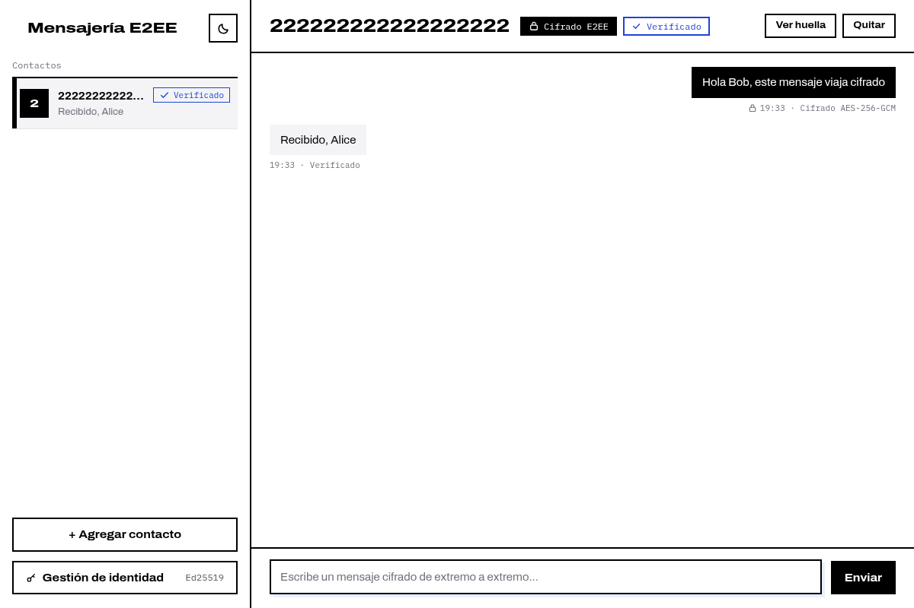
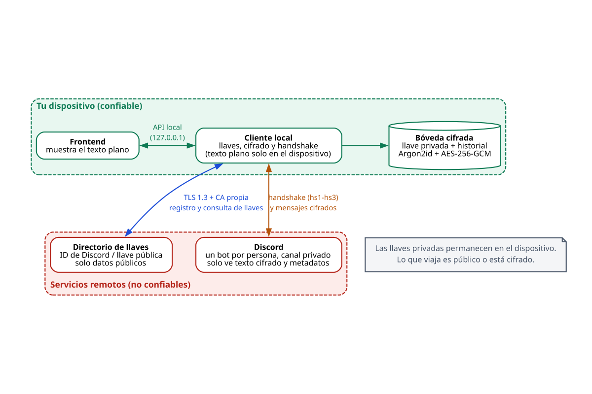
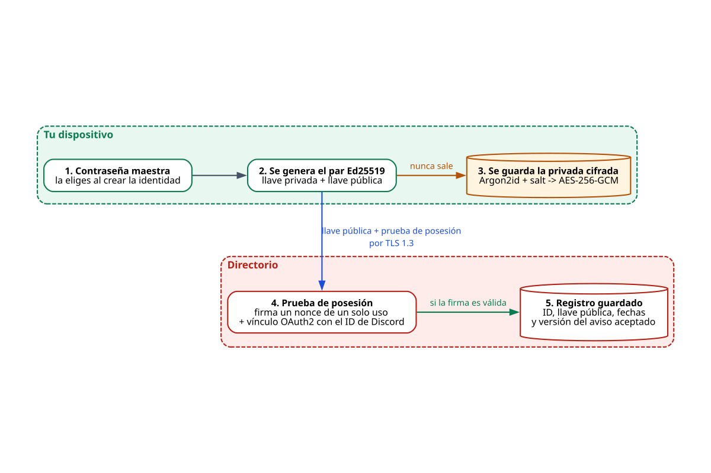
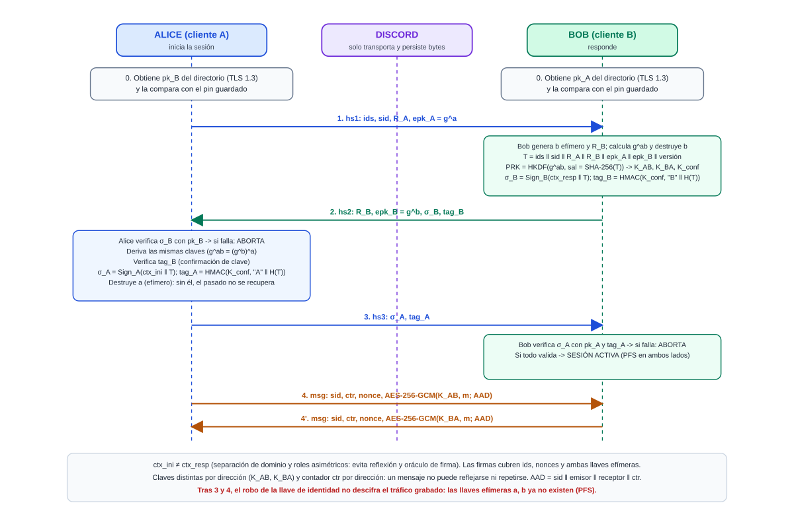
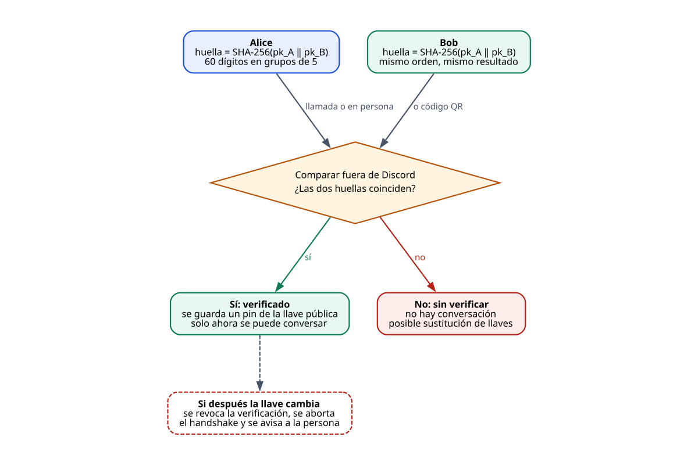

# Primera entrega: planificación y diseño

Este documento reúne completo lo que pide el esquema de la primera entrega (parcial): motivación, trasfondo teórico, requerimientos funcionales y de seguridad, diseño funcional y de seguridad, e implementación propuesta. Está actualizado con las decisiones que tomamos al implementar. El [informe final](README.md) resume estas secciones y agrega la implementación lograda, la privacidad y la ética, los resultados y la retrospectiva. Las referencias bibliográficas están al final del [informe final](README.md#referencias-bibliográficas).

## 1. Motivación

Mucha gente usa Discord para trabajos en grupo, clases y hasta cosas de trabajo. El problema es que Discord no cifra de extremo a extremo los mensajes: la empresa y sus servidores pueden leerlos en texto plano. Si hay una brecha, una orden legal o un empleado curioso, lo que escribimos (contraseñas, ideas, datos personales) queda expuesto.

Nuestro proyecto pone una capa de cifrado encima de Discord. Seguimos usando la plataforma que ya conocemos, pero Discord solo guarda texto cifrado que no puede leer. Los mensajes se cifran en el dispositivo de quien escribe y solo se descifran en el de quien recibe.

## 2. Trasfondo teórico

Estos conceptos nos ayudaron a decidir cómo proteger los mensajes y las llaves.

* **Cifrado de extremo a extremo (E2EE).** Solo quienes conversan pueden leer los mensajes; el servidor en medio solo ve bytes (Alatawi & Saxena, 2023; Park et al., 2023).
* **Criptografía híbrida.** La criptografía de llave pública es lenta y la simétrica es rápida, así que se combinan. La simétrica (AES-256-GCM) cifra los mensajes y además detecta si alguien los modificó. La de llave pública sirve para identificarnos (firmas Ed25519) y para acordar una clave compartida (Diffie-Hellman sobre X25519). Cada llave hace una sola cosa: la de identidad solo firma (Stallings, 2017; Ferguson et al., 2010).
* **Hash y derivación de claves.** SHA-256 sirve para la huella de verificación. HKDF saca varias claves independientes de un mismo secreto (Krawczyk & Eronen, 2010) y Argon2id vuelve lenta la fuerza bruta contra la contraseña maestra.
* **Protocolos y *forward secrecy* (PFS).** No basta con elegir un algoritmo seguro: también importa cómo lo usamos. El modelo de Dolev y Yao (1983) nos permite pensar en un atacante que controla la red. Buscamos que ambos participantes se identifiquen, acuerden una clave y protejan sus conversaciones anteriores si más adelante se roba su llave de identidad. Esto último se llama PFS. Para lograrlo usamos llaves temporales en ambos lados y las eliminamos después de obtener las claves de sesión, siguiendo ideas de SSH y TLS 1.3. También revisamos qué pasa si alguien repite o cambia los mensajes del intercambio (Abadi & Needham, 1996; Krawczyk, 2003).
* **Directorio de llaves y ataque de sustitución.** Hace falta un lugar donde publicar las llaves públicas. Si ese servidor se compromete, puede entregar la llave de un atacante y habría un *man-in-the-middle*. La publicación de llaves funciona como un tablón; la verificación fuera de banda permite detectar una sustitución (Park et al., 2023). En nuestra implementación, el mismo servicio también valida el segundo factor y guarda sus datos privados, separados de la consulta pública.
* **Verificación fuera de banda.** La solución a la sustitución de llaves es comparar una huella de las llaves por otro canal (llamada, en persona, QR), como hacen Signal o WhatsApp (Naor et al., 2018; Alatawi & Saxena, 2023). Así no dependemos de confiar a ciegas en el primer contacto, como pasa con SSH.
* **Autenticación multifactor (MFA).** Combina la contraseña con un código temporal de la app autenticadora. Usamos TOTP (RFC 6238), compatible con Microsoft Authenticator. Este control protege el acceso desde la aplicación; no cambia la clave que cifra los archivos locales ni evita por sí solo el phishing (NIST, 2025, SP 800-63B-4).
* **Discord API.** La API oficial no deja escribir en nombre de un usuario, así que cada persona usa su propio bot en un canal privado.

## 3. Requerimientos

Vamos a crear los requerimientos a partir del siguiente modelo de amenaza.

**Modelo de amenaza:** consideramos adversarios al proveedor de **Discord**, a quienes accedan a sus servidores y a atacantes pasivos o activos en la red. Asumimos que el dispositivo y el sistema operativo de la persona son confiables. Dejamos **fuera del alcance** la protección de los metadatos, la disponibilidad del servicio y el compromiso físico del dispositivo. El atacante activo puede intervenir en el protocolo (repetir, reflejar, reordenar o suplantar mensajes del *handshake*), pero no romper las primitivas criptográficas. También contemplamos que obtenga **más adelante** la llave de identidad de una persona, sin que eso exponga sus conversaciones pasadas.

Para distinguir entre un atacante pasivo y uno activo, usamos la definición de Dolev y Yao (1983): la diferencia está en **qué puede hacer con los mensajes que ve**. El pasivo solo observa, lee, copia y almacena. En cambio, el activo puede modificar un mensaje, borrarlo, retrasarlo, reordenarlo, editarlo, etc.

En la siguiente tabla aplicamos esa distinción a nuestro proyecto.

| Actor | Atacante pasivo | Atacante activo |
|---    |---              |---              |
| **Discord / proveedor** | Lee el contenido de los DMs y canales; conserva el historial en sus bases de datos; lo entrega ante requerimiento legal o lo pierde en una brecha | Podría alterar mensajes en tránsito o inyectar contenido falso atribuido a un usuario |
| **Red** | Captura tráfico en una WiFi abierta o en un nodo intermedio | Se interpone en la conexión con el directorio de llaves y responde en su lugar |
| **Directorio de llaves** | Un volcado de su base de datos revela qué usuarios se registraron y cuándo| **Sustitución de llaves:** devuelve la llave pública del atacante en lugar de la del receptor legítimo |

### 3.1. Requerimientos Funcionales
* **RF1:** El sistema debe generar localmente, en el dispositivo del usuario, un par de llaves de identidad de firma (Ed25519) durante el registro inicial.

* **RF2:** El sistema debe publicar la llave del usuario en un directorio de llaves, permitiendo a otras personas obtener esa llave con el identificador de su cuenta de Discord.

* **RF3:** El sistema debe cifrar con una llave simétrica cada mensaje antes de ser enviado por la API de Discord.

* **RF4:** El sistema debe establecer una clave de sesión compartida con el destinatario mediante un intercambio Diffie-Hellman efímero autenticado con las llaves de identidad, de modo que solo ambos extremos puedan derivarla.

* **RF5:** El sistema debe detectar y descifrar automáticamente los mensajes entrantes dirigidos al usuario, mostrando el texto plano únicamente en la interfaz local.

* **RF6:** El sistema debe generar y mostrar una huella digital criptográfica derivada de las llaves públicas de ambos interlocutores.

* **RF7:** El usuario debe verificar a cada contacto completando el proceso de autenticación fuera del canal. Sin un contacto _verificado_ no se abre ninguna sesión, no se envía ni se recibe ningún mensaje y la interfaz no permite escribirle.

* **RF8:** El sistema debe notificar al usuario cuando detecte, al consultar el directorio para iniciar o aceptar un *handshake* o al verificar, que la llave pública registrada de un contacto ya _verificado_ cambió, y revocar automáticamente su estado de verificación. Una sesión ya activa sigue funcionando hasta su próxima rotación.

* **RF9:** El sistema debe indicar visualmente, por cada conversación, si el canal esta cifrado y si la contraparte está verificada; mientras no lo esté, la conversación permanece bloqueada.

* **RF10:** El sistema debe autenticarse frente a Discord mediante OAuth2 o token de bot, sin exponer esas credenciales en la interfaz.

* **RF11:** El sistema debe permitir identificar un mensaje que no se pueda descifrar.

* **RF12:** Con la identidad desbloqueada, el usuario podrá exportar e importar su identidad criptográfica para usarla en otro dispositivo. El archivo exportado se protege con una contraseña de al menos 10 caracteres que el usuario elige al exportar (Argon2id y AES-256-GCM), y al importarlo la bóveda se vuelve a cifrar con esa contraseña.

* **RF13:** El sistema debe autenticar a ambos interlocutores al establecer una sesión, verificando la firma del otro extremo contra la llave publicada en el directorio, y rechazarla si no coincide con la llave verificada (*pin*).

* **RF14:** El sistema debe mantener en cola los mensajes del usuario mientras la sesión no esté establecida, y enviarlos cifrados cuando el *handshake* termine.

### 3.2. Requerimientos de Seguridad

* **RS1:** La llave privada del usuario debe permanecer en el sistema y no ser transmitido a algun tercero.

* **RS2:** La llave privada en el dispositivo debe estar cifrada con una clave derivada de la contraseña maestra con **Argon2id** y con _salt_ unico por usaurio.

* **RS3:** El texto plano debe permanecer en memoria el menor tiempo posible y no debe escribirse ni en registros ni archivos temporales.

* **RS4:** Todo cifrado simétrico debe emplear AES-256 en modo GCM, con un _nonce_ de 96 bits generado por un CSPRNG del sistema operativo. En las sesiones de mensajería, el cliente además lleva registro de los _nonces_ usados y nunca repite uno bajo la misma clave; en el almacén local y la bóveda, la unicidad depende de que el _nonce_ sea aleatorio.

* **RS5:** El sistema debe rechazar todo mensaje cuya etiqueta de autentiación GCM no se válida.

* **RS6:** La comunicación entre el cliente y el directorio de llaves debe realizarse sobre TLS 1.3, como defensa frente a un atacante en la red.

* **RS7:** El proceso de verificación de un usuario debe ser fuera del canal de Discord.

* **RS8:** La huella digital de verificación debe derivarse de las llaves públicas de ambas partes mediante una función hash (SHA-256), con un orden determinístico que produzca el mismo valor en ambos extremos.

* **RS9:** Las claves de sesión deben rotarse periódicamente (por número de mensajes y por tiempo) mediante un nuevo *handshake*, destruyendo las claves anteriores.

* **RS10:** Los tokens de acceso a la API de Discord deben gestionarse en variables de entorno.

* **RS11:** Todo el material criptográfico debe provenir de un generado de números aleatorios (pseudo-aleatorios) criptográficamente seguro.

* **RS12:** (*Perfect forward secrecy*) Las llaves Diffie-Hellman de sesión deben ser efímeras en ambos extremos y destruirse apenas se deriva la clave; el compromiso posterior de la llave de identidad no debe permitir descifrar sesiones pasadas.

* **RS13:** Toda firma del *handshake* debe cubrir las identidades de ambos interlocutores, los nonces, ambas llaves efímeras y la versión del protocolo, y debe llevar una cadena de contexto distinta según el rol (iniciador/respondedor). Toda sesión cuya firma o confirmación de clave no valide debe abortarse.

* **RS14:** El sistema debe rechazar mensajes repetidos, reordenados fuera de ventana o provenientes de otra sesión, mediante un contador por dirección y un identificador de sesión incluidos en los datos autenticados.

* **RS15:** Cada llave debe tener un único propósito: la llave de identidad solo firma; las llaves de sesión se derivan de forma independiente por dirección (emisor->receptor y receptor->emisor).

Durante la implementación agregamos RF15 y RS16 a RS21; están en la sección 3.1 del [informe final](README.md).

## 4. Diseño

Separamos el diseño en dos partes: cómo se usa la aplicación y cómo protege los mensajes.

### 4.1 Diseño funcional: interfaz y experiencia de usuario

La interfaz es una página web independiente de Discord. El desbloqueo habitual pide la contraseña maestra y un código nuevo de Microsoft Authenticator. La sesión local dura 30 minutos por defecto (`CLIENT_SESSION_TTL`); al vencer se bloquea y descarta las llaves de conversación. Los 30 minutos se cuentan desde el desbloqueo, aunque la persona siga usando la app. Cerrar solo la pestaña no detiene el cliente local. Si el directorio no responde, la identidad y el historial permanecen bloqueados.

Cada conversación muestra su estado:

* **Candado:** hay sesión cifrada activa. Mientras el *handshake* no termina dice "estableciendo sesión" y los mensajes esperan en cola (RF14).
* **Insignia de verificado:** la persona comparó la huella fuera de Discord.
* **Alerta de cambio de llave:** si cambia la llave de un contacto verificado, se revoca la verificación y se avisa.
* **"Mensaje no descifrable":** para mensajes que no se pueden autenticar o descifrar.

  

| Elemento de interfaz | Requerimientos |
|---|---|
| Candado y estado de sesión | RF3, RF9, RF13, RF14 |
| Insignia de verificado | RF7, RF9 |
| Alerta y revocación automática | RF8 |
| "Mensaje no descifrable" | RF11 |
| Registro, autenticación e identidad | RF1, RF2, RF10, RF12 |
| Desbloqueo con contraseña y TOTP; vencimiento de sesión local | C-25 de la DPIA |

### 4.2 Diseño de seguridad: algoritmos y protocolos

Seguimos el patrón de SSH y TLS 1.3: **identidad de largo plazo que solo firma, Diffie-Hellman efímero para la sesión y cifrado autenticado para los mensajes** (Ed25519, X25519, HKDF-SHA256 y AES-256-GCM).

> **Decisión de diseño.** En la primera entrega cifrábamos contra la llave pública de identidad del receptor. Nos dimos cuenta de que así no hay *forward secrecy*: quien robe esa llave descifra todo el historial. Por eso ahora la identidad solo firma y las llaves de sesión son efímeras en ambos extremos.

#### 4.2.1 Arquitectura y límite de confianza

En el **dispositivo de cada persona** quedan los mensajes legibles y las claves privadas: la interfaz muestra los mensajes y el cliente local gestiona las llaves. El **directorio**, desplegado en EC2 en Virginia del Norte (`us-east-1`) con PostgreSQL en Supabase, publica la asociación ID de Discord <-> llave pública de firma y valida el segundo factor por TLS 1.3 (RS6). PostgreSQL guarda también el secreto TOTP cifrado, hashes de recuperación y el estado necesario para impedir reutilizaciones; esos datos no se publican con las llaves. La clave `TOTP_ENCRYPTION_KEY` se configura fuera de la base. **Discord** transporta y guarda el intercambio para iniciar la conversación y los mensajes cifrados.

Para respaldar el directorio, un proceso en EC2 lee PostgreSQL en Supabase con un rol de solo lectura, cifra el volcado con AES-256-GCM y lo sube por HTTPS al bucket privado `proyecto-eticayseguridad` en Amazon S3, en `us-east-1`. La copia pasa por EC2 ya cifrada en disco; el contenido legible del volcado solo se procesa en memoria. Conservamos las copias durante 30 días con rotación. S3 respalda los datos del directorio, incluidos los datos privados de autenticación; el historial, los contactos y las llaves privadas de mensajería permanecen en cada dispositivo.

La bóveda local guarda la llave privada de identidad y la clave del almacén. El historial, los contactos y la cola están en otro archivo cifrado con esa clave. La contraseña maestra protege la bóveda mediante Argon2id y AES-256-GCM; el MFA controla el desbloqueo desde la aplicación.

Como el autor que muestra Discord siempre es un bot, no confiamos en él: el emisor y el receptor van dentro del mensaje y se autentican con el *handshake*. Cada cliente ignora lo que no va dirigido a su ID.

  

#### 4.2.2 Registro y custodia de la identidad

Al registrarse, el cliente genera el par Ed25519 en el dispositivo (RF1). La llave privada se cifra con Argon2id y la contraseña maestra (RS2) y nunca sale (RS1). En el directorio solo se publica la llave pública (RF2). Para registrar, cambiar o cancelar una llave, el directorio exige OAuth2 de Discord, un código TOTP y una firma que demuestra que la persona tiene la llave privada. El flujo Discord -> Authenticator entrega un token de registro de diez minutos y un solo uso para la operación. Al vincular el autenticador se muestran diez códigos de recuperación una sola vez; se guardan fuera del dispositivo. El QR se genera en el propio servicio.

El desbloqueo habitual usa otro flujo, sin repetir OAuth2 ni guardar una autorización para la próxima vez:

| Paso | Qué ocurre |
|---|---|
| 1. Contraseña | El cliente abre la bóveda en memoria con la contraseña maestra, pero todavía no habilita las conversaciones |
| 2. Desafío firmado | Solicita un nonce de hasta 120 segundos, con propósito `unlock`, y lo firma mediante `sign_unlock`, ligado al ID y con contexto propio |
| 3. Segundo factor | El directorio verifica la firma con la llave registrada y comprueba el TOTP de seis dígitos. Rechaza códigos repetidos; cinco fallos bloquean el factor durante cinco minutos |
| 4. Sesión local | Solo si la validación termina bien se abre el historial y comienza el plazo local de 30 minutos. Un fallo de red o de autenticación mantiene la identidad bloqueada |

**Qué protege el segundo factor.** Una copia de `vault.json` y `store.enc`, junto con la contraseña correcta, se puede descifrar con otro programa. El segundo factor limita el acceso desde nuestra aplicación. La bóveda, que guarda la identidad cifrada, sigue dependiendo de la contraseña. Crear o importar una identidad ya usa la autorización del registro, por eso no repite el desafío de desbloqueo. El modo `client.dev` usa servicios en memoria y no valida MFA. La configuración real con Authenticator está desplegada y probada en EC2.

  

#### 4.2.3 Establecimiento de sesión: *handshake* autenticado con PFS

Antes de chatear, A y B intercambian tres mensajes por Discord para acordar las claves. Llamamos `T` al conjunto de datos de ese intercambio: los IDs, el identificador de sesión (`sid`), los valores aleatorios de un solo uso (`R_A` y `R_B`), las llaves públicas temporales (`epk_A` y `epk_B`) y la versión. Las firmas comprueban que estos datos no hayan cambiado.

| Paso | Qué pasa |
|---|---|
| **hs1** (A->B) | A genera su llave efímera y `R_A` y envía `ids, sid, R_A, epk_A`. Antes, ambos comprueban que el contacto está verificado y consultan la llave del otro en el directorio para compararla con el *pin*. Si falta la verificación, no se envía ni se responde ningún *handshake*. |
| **hs2** (B->A) | B genera su llave efímera, calcula el secreto compartido, deriva las claves y **destruye su llave efímera**. Responde con su firma `σ_B` sobre `T` y una confirmación de clave `tag_B`. |
| **hs3** (A->B) | A verifica `σ_B` y `tag_B` (si fallan, aborta), deriva las mismas claves, responde con `σ_A` y `tag_A` y **destruye su llave efímera**. |
| **Activa** | B verifica `σ_A` y `tag_A`. Si todo valida, la sesión queda activa en ambos lados (RF13). |

Con HKDF se derivan tres claves independientes: `K_AB` (A->B), `K_BA` (B->A) y `K_conf` (confirmación). Los valores aleatorios se generan con el generador criptográfico del sistema operativo (CSPRNG), en lugar de un generador común (RS11).

**Por qué resiste los ataques** (RS12, RS13, RS15):

* **Autenticación mutua:** las firmas cubren toda la transcripción, así que cambiar una llave efímera las invalida.
* **PFS:** las llaves efímeras solo existen durante el *handshake*. Robar la identidad después no sirve para leer sesiones pasadas.
* **Reflexión y uso indebido de firmas:** quien inicia y quien responde firman con prefijos distintos (`ctx_ini` y `ctx_resp`). Así una firma de un paso no sirve para otro.
* **Degradación:** usamos una sola combinación de algoritmos y firmamos la versión para que no pueda cambiarse durante el intercambio.
* **Repetición de mensajes:** los valores aleatorios de un solo uso (*nonces*) y el identificador de sesión (`sid`) ayudan a rechazar mensajes antiguos; un intento pendiente caduca a los 5 minutos. Un `hs2`, `hs3` o `hs1` falso no cancela un intento legítimo en curso.

**Cola y reintentos.** Los mensajes escritos sin sesión esperan en una cola local cifrada (RF14). Si el otro no responde, el cliente destruye su llave efímera y reintenta con espera creciente (15, 30, 60 min…). Pasado el máximo, muestra "contacto no disponible".

  

#### 4.2.4 Protocolo de mensajería

1. **Cifrado.** Usamos AES-256-GCM con una clave distinta para cada dirección y un valor aleatorio de 96 bits generado por el sistema. También comprobamos el identificador de sesión, el emisor, el receptor y el contador (`sid`, `emisor`, `receptor`, `ctr`), para detectar cambios en esos datos (RF3, RS4, RS11).
2. **Envío.** Viaja por Discord como `E2EE1:{sid, ctr, nonce, ciphertext+tag}`. Hasta 900 bytes por mensaje; lo más largo se parte.
3. **Recepción.** Se revisa que `sid` sea de una sesión activa y que `ctr` no se haya visto ni esté fuera de ventana (RS14). Luego se descifra verificando la etiqueta GCM; si no valida, se marca "no descifrable" (RF5, RF11, RS5).

No firmamos cada mensaje a propósito: una firma por mensaje serviría de prueba ante terceros (no repudio), algo que una charla privada no necesita. Como SSH y TLS, firmamos el *handshake* y no cada registro.

#### 4.2.5 Rotación de claves y destrucción

La sesión de conversación se renueva con un nuevo *handshake* a los 100 mensajes, a las 8 h o cuando la persona lo pida (RS9). El vencimiento de la sesión local autenticada (30 minutos por defecto) también destruye las sesiones de conversación; ambos plazos son controles distintos. Las claves anteriores se destruyen tras una ventana corta de gracia. Como consecuencia de la PFS, Discord guarda mensajes que ya nadie puede descifrar con esas claves; por eso el cliente guarda el historial **ya descifrado** en un almacén local cifrado con AES-256-GCM (clave derivada de la contraseña maestra).

#### 4.2.6 Comparación de huellas

Las firmas no impiden que un directorio malicioso entregue una llave propia, así que añadimos la verificación (RS7). Ambos calculan `SHA-256(pk_A ‖ pk_B)` con las llaves ordenadas (RS8) y la muestran como 60 dígitos en grupos de cinco. La comparan **fuera de Discord**; ambos extremos deben hacerlo antes de conversar y, sin esta comparación, no hay sesión ni mensajes (RF7). Si coinciden, el cliente guarda "verificado" y una copia de la llave pública para detectar cambios; a esto lo llamamos *pin*. Si después la llave cambia, se revoca la verificación, se aborta el *handshake* y se avisa (RF8). No hay botón de "continuar de todos modos".

  

#### 4.2.7 Análisis de ataques

| Ataque | Defensa |
|---|---|
| Espionaje pasivo (Discord, red) | AES-256-GCM; las claves salen de DH efímero que no viaja |
| *Man-in-the-middle* en el *handshake* | Las firmas cubren ambas llaves efímeras y los ids (RS13) |
| Sustitución de llaves en el directorio | TLS 1.3 con CA propia, verificación fuera de banda y *pin* (RS6, RS7, RF8). **Riesgo que queda:** que la comparación fuera de banda la haga mal la persona o que ese otro canal también esté comprometido |
| *Replay* de *handshake* o mensajes | Nonces, `sid`, contador `ctr` y ventana (RS14); caducidad de intentos |
| Reflexión | Roles asimétricos, ids firmados, claves por dirección (RS13, RS15) |
| Oráculo de firma o descifrado | La identidad solo firma con prefijo de contexto (RS15); `sign_unlock` usa un contexto distinto al registro y al cambio de llave |
| Repetición de TOTP o de un desbloqueo | Desafío aleatorio de un solo uso para `unlock`, firma ligada al ID y rechazo del código TOTP ya aceptado; no se guarda una autorización para futuros desbloqueos |
| Degradación | Suite única; versión en la transcripción firmada |
| Suplantación (*misbinding*) | Ids de ambos dentro de la firma y del AAD |
| Robo posterior de la llave de identidad | PFS (RS12). No protege sesiones **futuras** ni un dispositivo ya comprometido |
| Alteración o inyección | Etiqueta GCM con AAD (RS5) |
| Borrado o reordenamiento por Discord | Se detecta por `ctr`; la disponibilidad queda fuera de alcance |

#### 4.2.8 Respaldo y recuperación del directorio

Diseñamos el respaldo como un flujo separado de la mensajería. EC2 ejecuta `pg_dump` sobre el esquema del directorio en Supabase con el rol de solo lectura. Excluimos del volcado los datos temporales de OAuth, los tokens, los desafíos y las sesiones de vinculación MFA. El proceso cifra el resultado en memoria con una clave independiente, `BACKUP_KEY`, y escribe únicamente la copia cifrada antes de enviarla a S3.

Antes de subir, comprobamos que el bucket tenga bloqueado el acceso público y no tenga versionado, para evitar que sobrevivan versiones ocultas de copias que deban borrarse. Tras la subida, verificamos el tamaño y SHA-256; solo si coinciden eliminamos las copias de más de 30 días del prefijo del proyecto. AWS CLI usa el rol de EC2 con permisos limitados al bucket y su prefijo.

Para restaurar necesitamos la copia y `BACKUP_KEY`. Para volver a validar los autenticadores de los registros restaurados necesitamos además la `TOTP_ENCRYPTION_KEY` original, porque los secretos TOTP ya estaban cifrados dentro de PostgreSQL. Custodiamos esas claves por separado del bucket; ninguna copia de S3 contiene las conversaciones ni las identidades locales de las personas.

Definimos una copia diaria, un objetivo de pérdida máxima de 24 horas de datos (RPO) y un objetivo de recuperación de 30 minutos (RTO). Instalamos la tarea programada y probamos la descarga y restauración de una copia de S3 en PostgreSQL aislado. Nos falta observar una ejecución automática, probar el inicio de sesión del servicio recuperado y medir el RTO. La configuración y el ensayo se describen en la [guía de despliegue](guia/despliegue-ec2.md#8-activar-el-respaldo-diario-de-supabase-en-s3).

## 5. Implementación propuesta

### 5.1 Esquema criptográfico concreto

| Elemento | Algoritmo / parámetro |
|---|---|
| Identidad | Ed25519, un par por usuario, generado en el dispositivo |
| Acuerdo de clave | X25519 efímero en ambos extremos, destruido al derivar la clave |
| Derivación | HKDF-SHA256 con sal `SHA-256(T)`; salidas `K_AB`, `K_BA`, `K_conf` |
| Confirmación de clave | HMAC-SHA256 con `K_conf` sobre `SHA-256(T)` |
| Mensajes | AES-256-GCM, nonce de 96 bits, AAD = `sid ‖ emisor ‖ receptor ‖ ctr` |
| Custodia de la identidad | Argon2id + salt único; AES-256-GCM sobre la llave privada |
| Desbloqueo habitual | Contraseña local + desafío firmado + TOTP validado por el directorio; sesión local de 1800 s por defecto |
| Huella | SHA-256 sobre las llaves ordenadas, 60 dígitos |
| Rotación | Nuevo *handshake* cada 100 mensajes o 8 h |

### 5.2 Tecnologías y fases de ejecución

Usamos Python 3.12 (`cryptography`, `argon2-cffi`, FastAPI) para el cliente local, Next.js para el frontend y `discord.py` para el transporte por Discord. Desplegamos el directorio FastAPI con Docker en AWS EC2 y alojamos PostgreSQL en Supabase. Para los respaldos usamos `pg_dump`/`pg_restore`, cifrado AES-256-GCM y AWS CLI para subir y verificar las copias en un bucket privado de Amazon S3. Gestionamos el código con Git y mantenemos los secretos fuera del repositorio.

Trabajamos en seis fases:

1. Núcleo criptográfico con pruebas de los caminos de rechazo.
2. Almacén local de identidad (bóveda, exportar e importar).
3. Directorio de llaves y cliente HTTPS.
4. Integración con Discord.
5. Verificación: huellas, QR, indicadores y alertas.
6. Despliegue del directorio en EC2 con Supabase, copias cifradas en S3 y ensayo de restauración.

### 5.3 Limitaciones reconocidas

El sistema protege el contenido, no el patrón de comunicación. Además:

* Solo hay conversaciones de dos personas; no hay grupos. Quien esté en el canal ve quién habla con quién y cuándo (metadatos).
* El *handshake* es interactivo: ambos deben estar conectados. Mientras tanto los mensajes esperan en la cola cifrada. Los reintentos solo corren con la app abierta, porque la llave efímera pendiente nunca se guarda en disco (para no romper la PFS).
* Por la PFS, Discord guarda mensajes que ya no se pueden descifrar; el historial vive descifrado en el almacén local cifrado.
* La verificación depende de que la persona compare bien la huella por un canal ajeno a Discord y al directorio.
* No hay seguridad posterior al compromiso dentro de una sesión (*ratchet* por mensaje) ni no repudio.
